<p align="center">
  
</p>

<h1 align="center">HikariSub</h1>

<p align="center">A subtitle editor for timing, translating, typesetting and karaoke, with a frame-accurate video player, Projects, plugins and Hikari AI.</p>

<p align="center"><a href="https://hikarisub.org">Website and user guide</a></p>

<picture>
  <source media="(prefers-color-scheme: dark)" srcset="docs/readme/hero-dark.webp">
  <source media="(prefers-color-scheme: light)" srcset="docs/readme/hero-light.webp">
  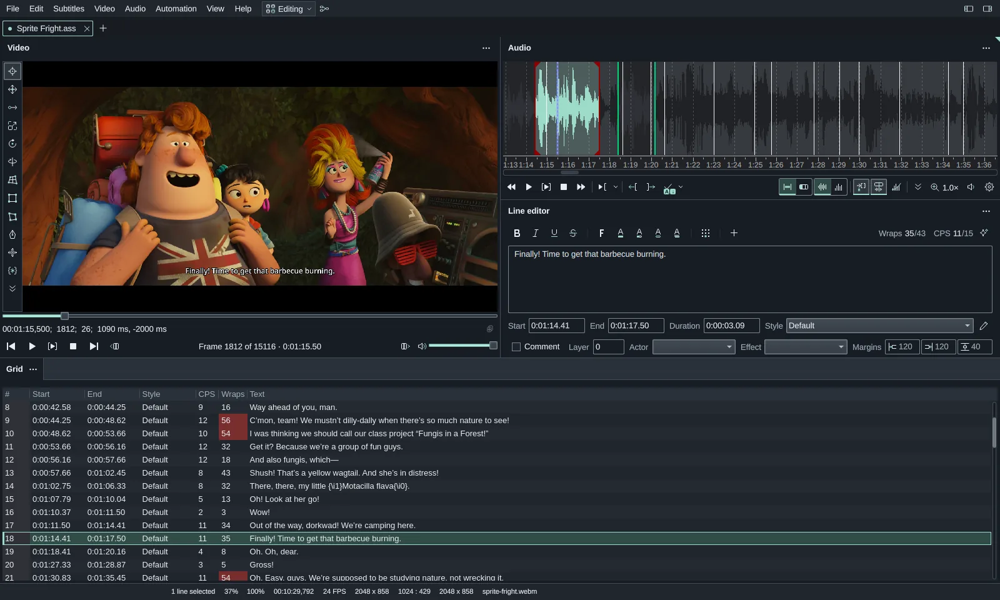
</picture>
<p align="center"><sub><i>Sprite Fright</i> © Blender Foundation, <a href="https://studio.blender.org/films/sprite-fright/">studio.blender.org</a>, CC BY 4.0 · Subtitles: Wikimedia Commons TimedText contributors, CC BY-SA 4.0</sub></p>

This is HikariSub 0.1, on the `main` branch. The latest release is [0.1.0-beta.4](https://github.com/altqx/hikari/releases/tag/v0.1.0-beta.4). The wxWidgets app it replaces, [HikariSub legacy](https://github.com/altqx/hikari/tree/legacy) (0.0.x), is still maintained.

## Features

<table>
  <tr>
    <td width="50%">
      <picture>
        <source media="(prefers-color-scheme: dark)" srcset="docs/readme/projects-dark.webp">
        <source media="(prefers-color-scheme: light)" srcset="docs/readme/projects-light.webp">
        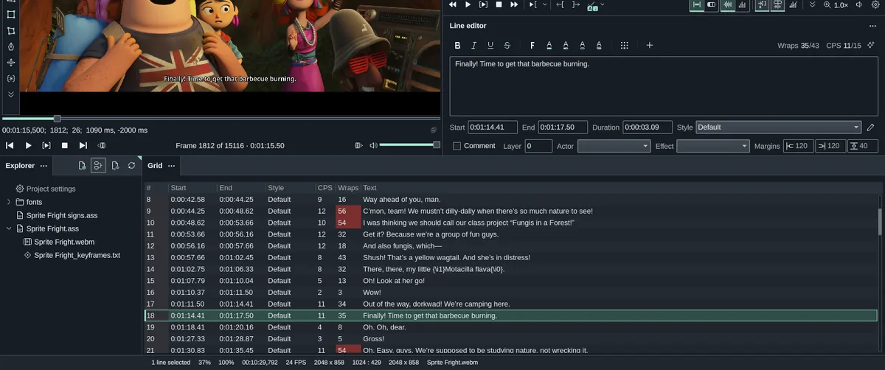
      </picture>
      <p>Projects: open a folder and its subtitles, fonts, catalogues, presets and scripts are shared by everyone who opens it. The Explorer panel lists its files.</p>
    </td>
    <td width="50%">
      <picture>
        <source media="(prefers-color-scheme: dark)" srcset="docs/readme/windows-dark.webp">
        <source media="(prefers-color-scheme: light)" srcset="docs/readme/windows-light.webp">
        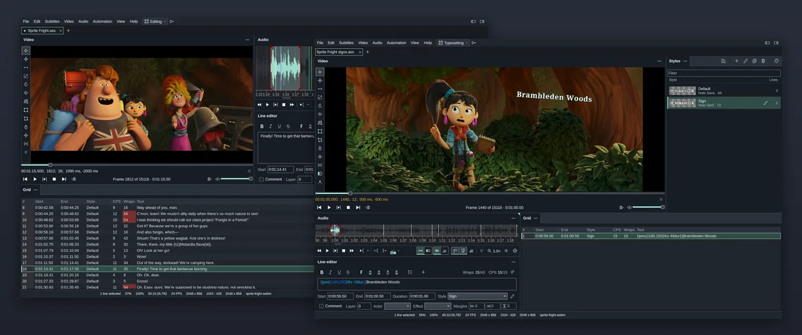
      </picture>
      <p>Several windows, each with its own tabs, panels, video and audio. Drag a tab out to make a new one.</p>
    </td>
  </tr>
  <tr>
    <td width="50%">
      <picture>
        <source media="(prefers-color-scheme: dark)" srcset="docs/readme/ai-review-dark.webp">
        <source media="(prefers-color-scheme: light)" srcset="docs/readme/ai-review-light.webp">
        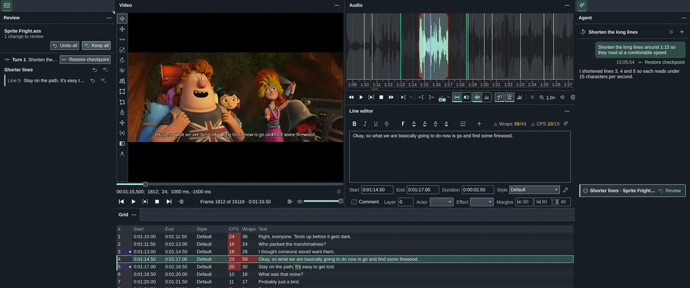
      </picture>
      <p>Hikari AI works on your subtitles in threads, on your own provider or on Claude Code, Codex or an ACP agent. Every edit waits in the Review panel until you keep or undo it.</p>
    </td>
    <td width="50%">
      <picture>
        <source media="(prefers-color-scheme: dark)" srcset="docs/readme/plugins-dark.webp">
        <source media="(prefers-color-scheme: light)" srcset="docs/readme/plugins-light.webp">
        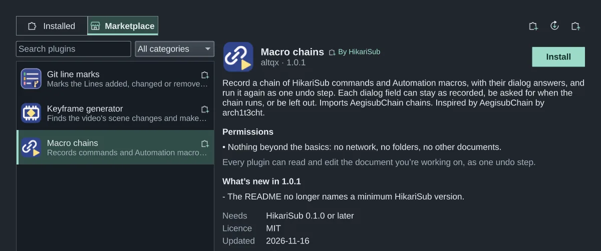
      </picture>
      <p>Plugins add commands, panels, dialogs and node effects. Install them from the marketplace; ordinary plugins run in a sandbox and ask before they use a folder.</p>
    </td>
  </tr>
  <tr>
    <td width="50%">
      <picture>
        <source media="(prefers-color-scheme: dark)" srcset="docs/readme/typesetting-dark.webp">
        <source media="(prefers-color-scheme: light)" srcset="docs/readme/typesetting-light.webp">
        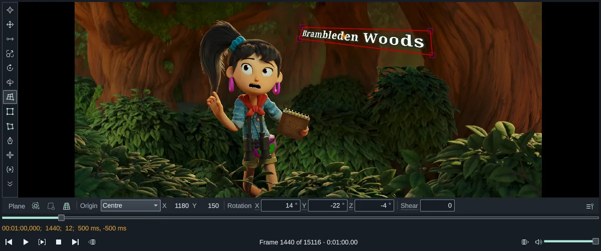
      </picture>
      <p>Visual typesetting on the video: position, rotation, perspective, clips, drawings, gradients and text on a path, each with exact values in an inspector bar.</p>
    </td>
    <td width="50%">
      <picture>
        <source media="(prefers-color-scheme: dark)" srcset="docs/readme/motion-tracking-dark.webp">
        <source media="(prefers-color-scheme: light)" srcset="docs/readme/motion-tracking-light.webp">
        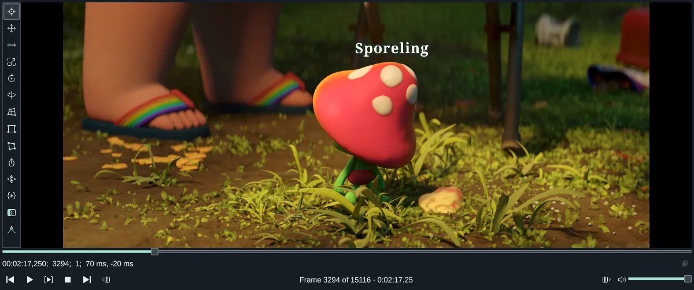
      </picture>
      <p>Motion and perspective tracking: apply After Effects keyframe data from Mocha or Blender, or Power-Pin data, to the selected lines.</p>
    </td>
  </tr>
  <tr>
    <td width="50%">
      <picture>
        <source media="(prefers-color-scheme: dark)" srcset="docs/readme/audio-dark.webp">
        <source media="(prefers-color-scheme: light)" srcset="docs/readme/audio-light.webp">
        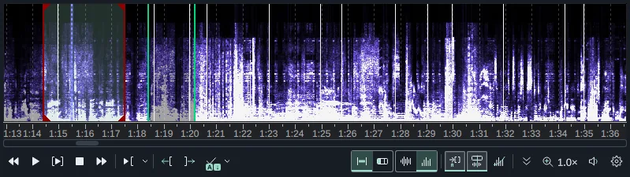
      </picture>
      <p>Waveform or spectrum, with keyframes, karaoke syllables you split and time on the audio, tap to time and onset snap.</p>
    </td>
    <td width="50%">
      <picture>
        <source media="(prefers-color-scheme: dark)" srcset="docs/readme/translation-dark.webp">
        <source media="(prefers-color-scheme: light)" srcset="docs/readme/translation-light.webp">
        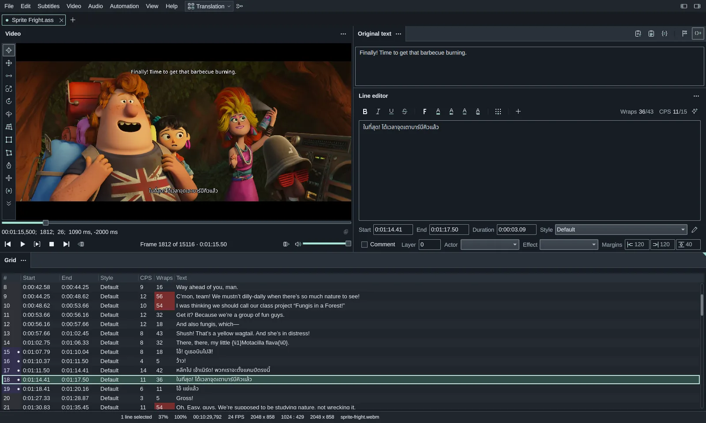
      </picture>
      <p>Translation mode keeps the original text beside your translation, on the video too if you want.</p>
    </td>
  </tr>
  <tr>
    <td width="50%">
      <picture>
        <source media="(prefers-color-scheme: dark)" srcset="docs/readme/checking-dark.webp">
        <source media="(prefers-color-scheme: light)" srcset="docs/readme/checking-light.webp">
        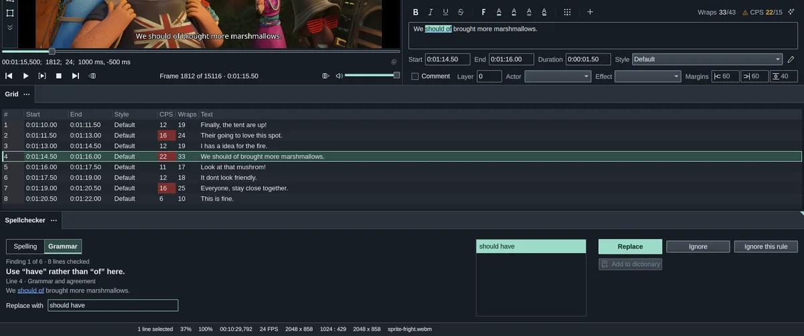
      </picture>
      <p>Spelling in every installed dictionary at once and an offline grammar check for English, with QC notes kept in the file.</p>
    </td>
    <td width="50%">
      <picture>
        <source media="(prefers-color-scheme: dark)" srcset="docs/readme/layouts-dark.webp">
        <source media="(prefers-color-scheme: light)" srcset="docs/readme/layouts-light.webp">
        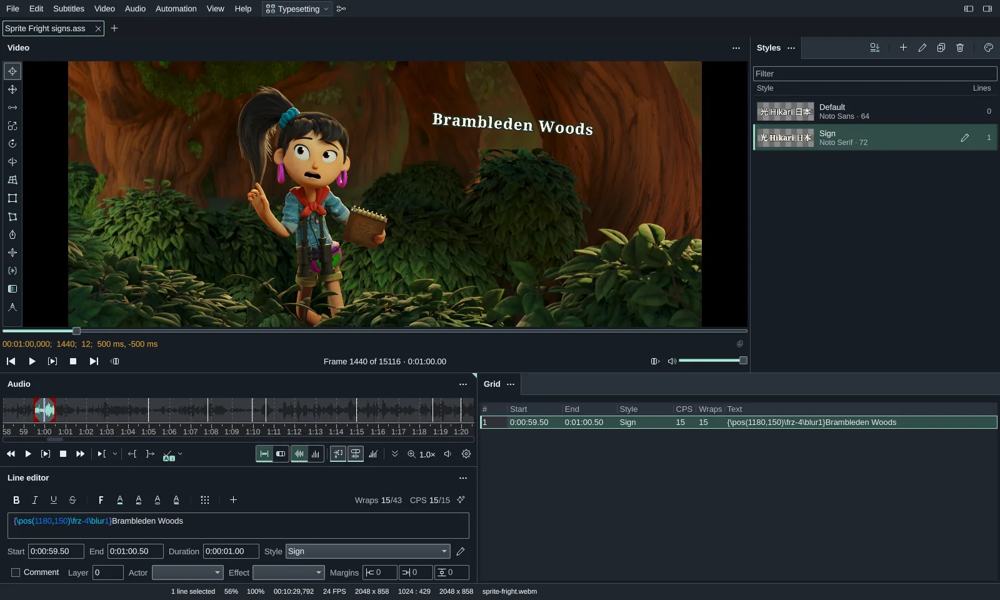
      </picture>
      <p>Dockable panels and side bars with Editing, Timing, Translation, Typesetting and Karaoke layouts. Each tab keeps its own.</p>
    </td>
  </tr>
  <tr>
    <td width="50%">
      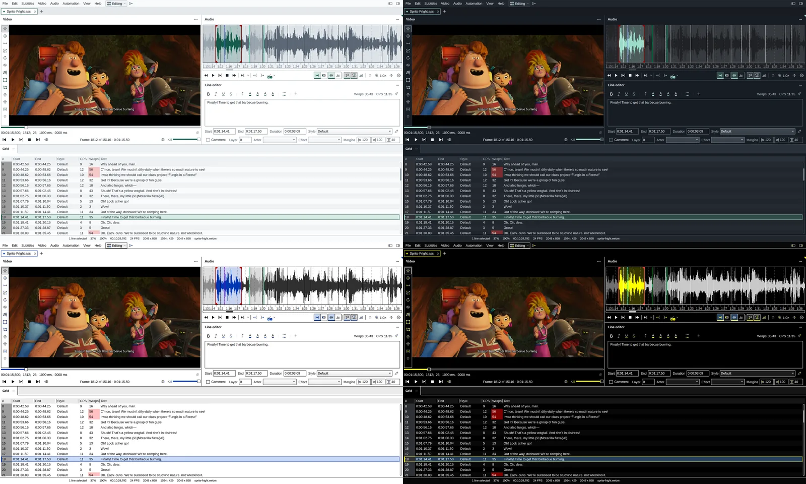
      <p>Light, Dark and two high-contrast themes, with seven accent colours.</p>
    </td>
    <td width="50%">
      <picture>
        <source media="(prefers-color-scheme: dark)" srcset="docs/readme/fullscreen-dark.webp">
        <source media="(prefers-color-scheme: light)" srcset="docs/readme/fullscreen-light.webp">
        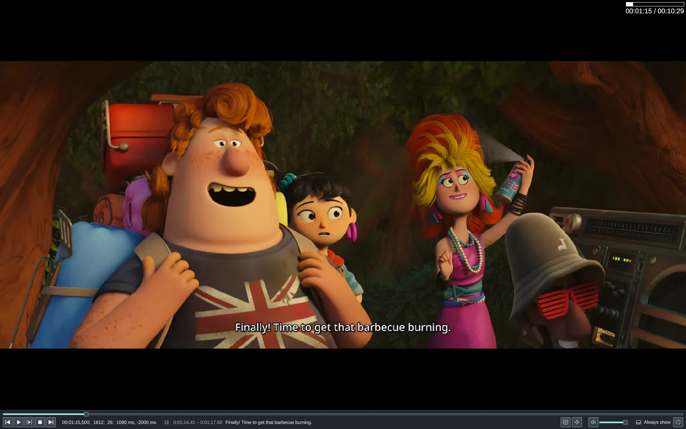
      </picture>
      <p>A full-screen player, with libass rendering every frame.</p>
    </td>
  </tr>
</table>
<p align="center"><sub><i>Sprite Fright</i> © Blender Foundation, <a href="https://studio.blender.org/films/sprite-fright/">studio.blender.org</a>, CC BY 4.0 · Subtitles: Wikimedia Commons TimedText contributors, CC BY-SA 4.0</sub></p>

<details>
<summary><b>Every feature</b></summary>

### Projects and windows

- Open a folder as a Project. Its `.hikari` folder keeps what a show shares: settings, fonts, dictionary words, style and font catalogues, layouts, presets, scripts, plugin settings and AI keys. A Project that brings scripts asks you to trust it first.
- The Explorer panel opens, renames, trashes and adds subtitle files in the Project.
- Several windows, each with its own tabs, panels, layout, video and audio. Sessions bring every window back.
- Side bars at the window's edges: AI on the left, tools on the right.
- Five built-in layouts and your own saved ones, which you can lock. A tab's layout is also kept in the ASS file.

### Files

- Opens ASS, SSA, SRT, MicroDVD, MPL2, TMPlayer, TTML, YouTube timed text (srv3) and plain text. Saving as ASS lists what changes first.
- Exports a copy as SRT, WebVTT, YouTube SBV, plain text, MicroDVD, MPL2, TMPlayer, TTML (IMSC1), DFXP or srv3, with a report of what each format can't carry.
- Imports word-timed lyrics (enhanced LRC, TTML, and decoded KRC and QRC) as karaoke lines.
- Loads subtitle tracks from MKV files, compressed ones included, and extracts their attached fonts.
- Autosaves, a browser for them, last-session restore and crash recovery.
- Every command can have its own shortcut, and menus show the current one.
- Imports the settings of HikariSub legacy, with a review of conflicts and a roll back.
- Interface in English, Korean, Polish, Tamil and Thai.

### Editing

- A Grid with filters, line groups inside line groups, sorting, hidden columns, joins, splits, and position, alignment, line-break and case commands.
- A Line editor with tag highlighting, a tag button strip, and characters-per-second and line-length counters.
- Styles panel and style manager with style catalogues and a live preview.
- One Find panel for this document, the open documents or a folder; select lines, resample and script properties.
- Subtitle comparison and a reference document.
- Hunspell spelling in every installed dictionary at once, and Harper's offline grammar check for English.
- QC notes kept in the subtitle file, with Note Browser and mpvQC import.
- Font collector and font catalogues.

### Hikari AI

- The Agent panel works in threads on your provider or on Claude Code, Codex or an ACP agent on your computer. It can time karaoke, typeset signs, build node effects, write scripts and plugins, search the web, use MCP tools and split work across sub-agents.
- Every AI edit waits in the Review panel, the Grid and the Line editor until you keep or undo it. Each thread has a mode and a cost cap.
- AI actions in the right-click menus: Rewrite, Shorten to 15 CPS, Fix spelling and grammar, Translate, and your own.
- Agents you run yourself can edit your open files through MCP, with their edits in the Review panel too.
- All AI features can be turned off in one place.

### Translation

- Translation mode with an Original text panel, the original shown on the video if you want, and jumps to untranslated lines.
- Tags from original gives the translation the original's tags.
- Thai marks stay on their letters in splits, karaoke, templates and scripts.

### Timing and audio

- Waveform, spectrum and speech-enhanced spectrum, with keyframe and second markers.
- Shift times and the Timing postprocessor as two panels with presets, timing helpers and a timing assistant.
- Audio output through PortAudio, with a choice of output device and mono playback.

### Karaoke

- Karaoke mode on the audio: split and join syllables, and time them on the waveform.
- Auto split by language, Thai included.
- Tap to time, with slowed playback from 25 % to 100 % that keeps the pitch.
- Syllable boundaries that snap to vocal onsets.
- Kanji timer, which copies syllable timing from romaji lines onto kanji lines.
- Check karaoke, which lists timing problems.
- The karaoke templater, built in, which also runs karaOK templates and comes with ten presets and the `ln.kara` library.
- Node effects: build karaoke and typesetting effects as a graph, previewed on the video and exported as template lines.

### Video

- Frame-accurate decoding with FFMS2 in a separate helper process, WebM, VP8, VP9 and AV1 included.
- Rendering with libass, from the [altqx/libass](https://github.com/altqx/libass) fork. On Windows, VSFilterMod can be chosen instead.
- Zoom and pan as in Aegisub 3.5, full screen, chapters, keyframes, timecodes and a dummy video.
- Saves a frame as PNG or copies it, with or without subtitles.

### Visual typesetting

Position, positioning in a rectangle, move, scale, Z rotation, X/Y rotation, perspective, rectangle and vector clips, vector drawings with shape presets, gradients, text on a path, the position shifter and Hydra (all tags), each with an inspector bar of exact values. Motion tracking, perspective tracking from Power-Pin data, Blur and glow layers, Remove tags and Interpolate across lines are built in.

### Automation and plugins

- Automation 4 on LuaJIT, with MoonScript, and Aegisub 3.5.1's Lua API with the additions of arch1t3cht's fork.
- Each script runs in its own helper process, outside the editor.
- DependencyControl with its native modules, and Aegisub-Motion bundled.
- An Automation panel with macro shortcuts, script dialogs with presets and repeat last run, and a progress card with a log for each run.
- Plugins from the marketplace or a `.hikariplugin` file, signed and sandboxed, with the official Macro chains, Keyframe generator and Git line marks plugins.
- The [Hikari API](https://hikarisub.org/en/docs/plugins/api-reference) for plugin authors: commands, panels, dialogs, node-effects nodes, long jobs, undo steps, Grid row marks, video frames, keyframes and git.

</details>

## Download

The latest release is [0.1.0-beta.4](https://github.com/altqx/hikari/releases/tag/v0.1.0-beta.4). Each release publishes these on the [releases page](https://github.com/altqx/hikari/releases):

| System | Download |
| --- | --- |
| Windows 10 (1809) or 11, x64 | `HikariSub-<version>-windows-x64-setup.exe` installer (just for you or for all users) or `.zip` portable |
| Linux x86_64, glibc 2.34 or later | `.AppImage`, `.deb`, `.rpm` or `.tar.gz` portable |

Nothing is code-signed. Each release lists SHA-256 sums in `SHA256SUMS`, signed with HikariSub's release key (minisign) in `SHA256SUMS.minisig`; [Checking a download](https://hikarisub.org/en/docs/get-started/install#checking-a-download) has the key and the commands. HikariSub legacy users are offered the update; moving is optional. [docs/distribution.md](docs/distribution.md) covers each package.

## Updates and privacy

HikariSub sends **anonymous usage data** to PostHog Cloud EU, through our own proxy at i.hikarisub.org, which forwards it and keeps no IP addresses or logs: which features and panels are used, errors and crashes, and how fast things open. It never sends your files, their names or paths, subtitle or script text, Style or font names, or anything you typed. Events go under a random install id, with no person profile and no location lookup, and the PostHog project discards IP addresses. Only release packages send. Turn it off in **Settings > Updates and privacy > Send anonymous usage data** or in Getting started; `DO_NOT_TRACK=1` turns it off for one run. [docs/analytics.md](docs/analytics.md) lists every event and property.

After a crash or a freeze, HikariSub shows the whole report it built: what crashed, your system, a settings summary and the last Log lines, with file names replaced. It is sent only when you press **Send report** (with usage data off too), or taken to a GitHub issue with **Open GitHub issue**; **Settings > Updates and privacy > Always send crash reports** sends it without asking. **Help > Report an issue…** fills in a GitHub issue form for a bug, a feature request or a question. [docs/crash-reports.md](docs/crash-reports.md) has the details.

**Discord presence** is off by default. **Settings > Updates and privacy > Show what I am doing in Discord** puts "Editing subtitles", the mode and the elapsed time in your Discord status, through the Discord app on your computer; **Include the file name** adds the file name. It never shows the video, your subtitles or line counts. [docs/discord-presence.md](docs/discord-presence.md) lists what is sent.

HikariSub looks for updates only when you choose **Help > Check for updates**, or once a day at most after you turn on **Settings > Updates and privacy > Check for updates automatically** (settings imported from legacy keep legacy's choice). The installer, AppImage, deb and rpm download the update, check its signature and SHA-256, and install it when you choose Restart now or quit. Only signed releases are installed. On a beta, **Stable versions only** starts off, so the next beta is offered.

<details>
<summary>What the update check sends and how updates install</summary>

- The check asks `api.github.com` for the release list. GitHub sees your IP address. Downloads come only from `github.com` and its asset hosts.
- What's new reads the same release list, only while the check is on. It never loads the images or links in the notes.
- Windows: the installed program checks the download again against the release's `SHA256SUMS` before it runs the installer. An all-users installation asks for administrator rights for this.
- AppImage: the old image is kept until the new one starts, and it is put back if the new one does not open its window.
- deb and rpm: a helper installs the package after the system's password prompt (`pkexec`), and only when the file matches the release's `SHA256SUMS`.
- Portable copies only say a new version is out.
- Turn off "Install updates automatically" to get only the notice.

</details>

## Build from source

The build is one CMake workflow. It downloads the pinned Qt 6.12.0 SDK and vcpkg dependencies itself:

```bash
git clone https://github.com/altqx/hikari.git
cd hikari
cmake --workflow --preset ubuntu-x64-release   # or fedora-x64-release, windows-x64-release
```

You need Git, CMake 3.29, Ninja, GCC and LLD on Linux or the latest MSVC on Windows, and a Qt Account login (or `QT_INSTALLER_JWT_TOKEN`) for the Qt installer. [docs/build.md](docs/build.md) lists the Linux packages and the other presets.

## License

GNU GPL v3, see [LICENSE](LICENSE). HikariSub began as a fork of [Kainote](https://github.com/bjakja/Kainote) by Marcin Drob (from commit `6e1bbb15`) and was rewritten in Qt.
