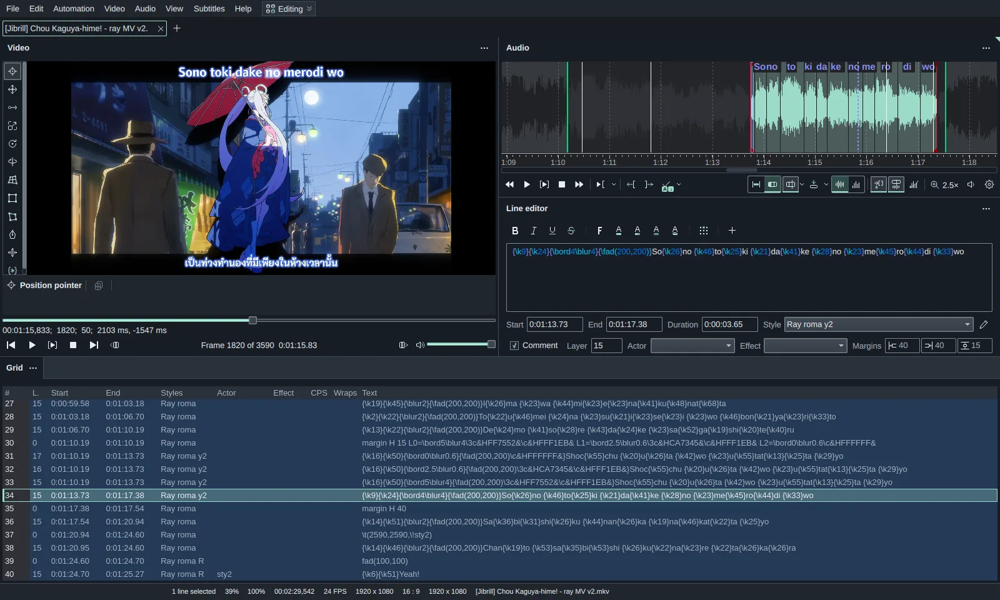
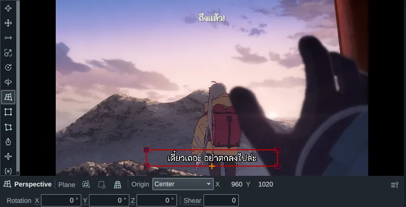
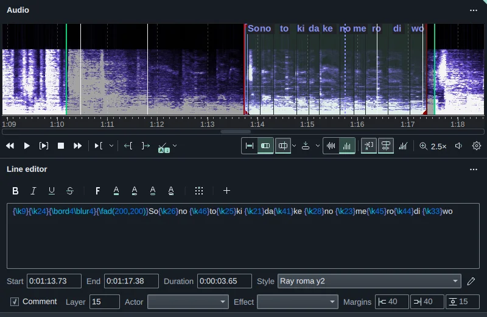
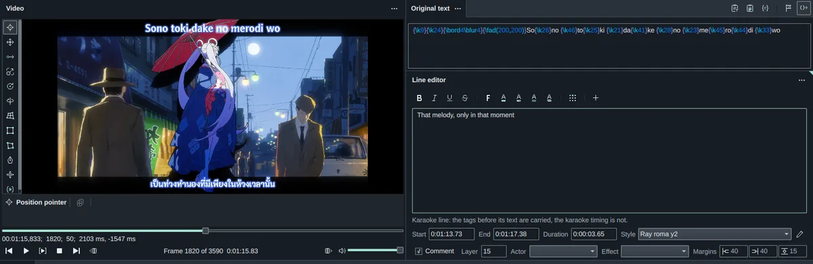
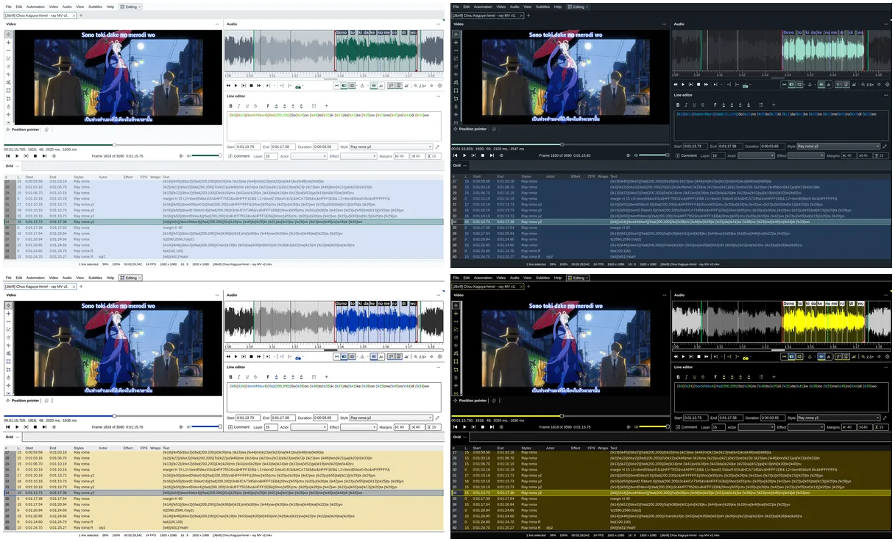
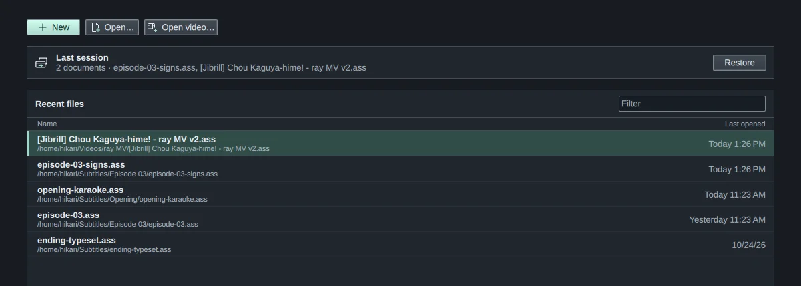
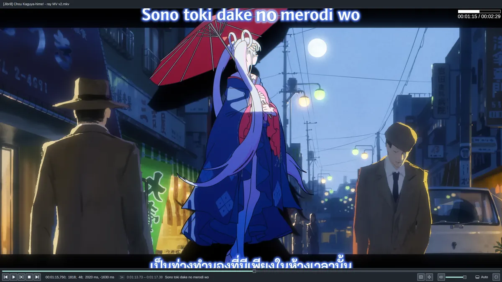
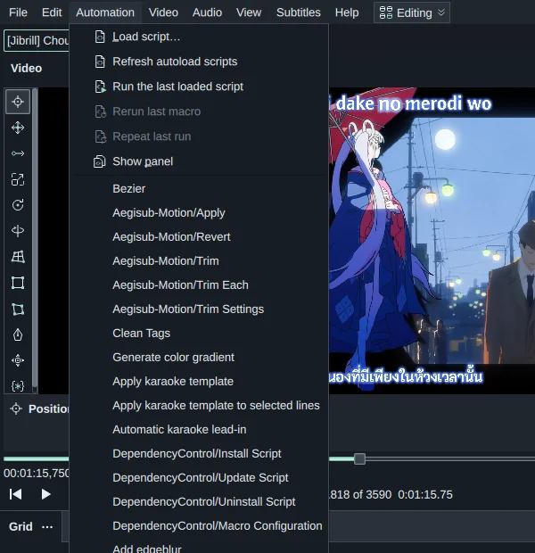

<p align="center">
  
</p>

<h1 align="center">HikariSub</h1>

<p align="center">A subtitle editor for timing, translating, typesetting and karaoke, with a frame-accurate video player.</p>

<picture>
  <source media="(prefers-color-scheme: dark)" srcset="docs/readme/hero-dark.webp">
  <source media="(prefers-color-scheme: light)" srcset="docs/readme/hero-light.webp">
  
</picture>
<p align="center"><sub>Subtitles: Jibrill</sub></p>

This is the Qt rewrite, version 0.1, on the `qt` branch. The wxWidgets app it replaces, [HikariSub legacy](https://github.com/altqx/hikari/tree/main) (0.0.x), is still maintained.

## Features

<table>
  <tr>
    <td width="50%">
      <picture>
        <source media="(prefers-color-scheme: dark)" srcset="docs/readme/layouts-dark.webp">
        <source media="(prefers-color-scheme: light)" srcset="docs/readme/layouts-light.webp">
        
      </picture>
      <p>Dockable panels with Editing, Timing, Translation and Typesetting layouts. Each tab keeps its own.</p>
    </td>
    <td width="50%">
      <picture>
        <source media="(prefers-color-scheme: dark)" srcset="docs/readme/perspective-dark.webp">
        <source media="(prefers-color-scheme: light)" srcset="docs/readme/perspective-light.webp">
        
      </picture>
      <p>Visual typesetting on the video, including a perspective tool that sets the rotation tags from four corners.</p>
    </td>
  </tr>
  <tr>
    <td>
      <picture>
        <source media="(prefers-color-scheme: dark)" srcset="docs/readme/audio-dark.webp">
        <source media="(prefers-color-scheme: light)" srcset="docs/readme/audio-light.webp">
        
      </picture>
      <p>Waveform or spectrum, with karaoke syllables you split and time on the audio.</p>
    </td>
    <td>
      <picture>
        <source media="(prefers-color-scheme: dark)" srcset="docs/readme/translation-dark.webp">
        <source media="(prefers-color-scheme: light)" srcset="docs/readme/translation-light.webp">
        
      </picture>
      <p>Translation mode keeps the original text beside your translation.</p>
    </td>
  </tr>
  <tr>
    <td>
      
      <p>Light, Dark and two high-contrast themes, with seven accent colours.</p>
    </td>
    <td>
      <picture>
        <source media="(prefers-color-scheme: dark)" srcset="docs/readme/home-dark.webp">
        <source media="(prefers-color-scheme: light)" srcset="docs/readme/home-light.webp">
        
      </picture>
      <p>A Home page with the last session and recent files. Work is autosaved and restored after a crash.</p>
    </td>
  </tr>
  <tr>
    <td>
      <picture>
        <source media="(prefers-color-scheme: dark)" srcset="docs/readme/fullscreen-dark.webp">
        <source media="(prefers-color-scheme: light)" srcset="docs/readme/fullscreen-light.webp">
        
      </picture>
      <p>A fullscreen player, with libass rendering every frame.</p>
    </td>
    <td>
      <picture>
        <source media="(prefers-color-scheme: dark)" srcset="docs/readme/automation-dark.webp">
        <source media="(prefers-color-scheme: light)" srcset="docs/readme/automation-light.webp">
        
      </picture>
      <p>Automation 4 scripts in Lua or MoonScript, Aegisub-Motion and DependencyControl included.</p>
    </td>
  </tr>
</table>
<p align="center"><sub>Subtitles: Jibrill</sub></p>

<details>
<summary><b>Every feature</b></summary>

### Files and workspace

- Opens ASS, SSA, SRT, MicroDVD, MPL2, TMPlayer and plain text, and saves or converts between them.
- Imports word-timed lyrics (enhanced LRC and TTML) as karaoke lines.
- Loads subtitle tracks from MKV files and extracts their attached fonts.
- Opens files in tabs, one window per session. A later start hands its files to the open window.
- Saved layouts of your own, next to the four built-in ones. A tab's layout is also kept in the ASS file.
- Autosaves, a browser for them, last-session restore and crash recovery.
- Every command can have its own hotkey.
- Imports the settings of HikariSub legacy, with a review of conflicts and a roll back.
- Interface in English, with partial Polish, Korean, Thai and Tamil translations.

### Editing

- A subtitle grid with filters, groups, sorting, hidden columns, joins and splits.
- A line editor with tag highlighting, a tag button strip, and characters-per-second and line-length counters.
- Styles panel and style manager with style catalogs and a live preview.
- Find and replace, select lines, fix minor errors, resample and ASS properties.
- Subtitle comparison and a reference document.
- Hunspell spellchecking.
- Font collector and font catalogs.

### Translation

- Translation mode with an Original text panel, the original shown on the video if you want, and jumps to untranslated lines.
- Tags from original gives the translation the original's tags.

### Timing and audio

- Waveform, spectrum and speech-enhanced spectrum, with keyframe and second markers.
- Shift times and the timing post-processor.
- Audio output through PortAudio, with a choice of output device.

### Karaoke

- Karaoke mode on the audio: split and join syllables, and time them on the waveform.
- Auto split by language.
- Tap to time, with slowed playback from 25 % to 100 % that keeps the pitch.
- Syllable boundaries that snap to vocal onsets.
- Kanji timer, which copies syllable timing from romaji lines onto kanji lines.
- Check karaoke, which lists timing problems.
- The karaoke templater.

### Video

- Frame-accurate decoding with FFMS2 in a separate helper process.
- Rendering with libass, from the [altqx/libass](https://github.com/altqx/libass) fork. On Windows, VSFilterMod can be chosen instead.
- Zoom, fullscreen, chapters, keyframes and a dummy video.
- Saves a frame as PNG or copies it, with or without subtitles.

### Visual typesetting

Position, positioning in a rectangle, move, scale, Z rotation, X/Y rotation, perspective, rectangle and vector clips, vector drawings with shape presets, the position shifter and Hydra (all tags), each with an inspector bar of exact values.

### Automation

- Automation 4 on LuaJIT, with MoonScript.
- Each script runs in its own helper process, outside the editor.
- DependencyControl with its native modules, and Aegisub-Motion bundled.
- An Automation panel with macro hotkeys, script dialogs with presets and repeat last run, and a progress card with a log for each run.

</details>

## Download

There is no Qt release yet; the first will be 0.1.0-beta.1. Each release will publish these on the [releases page](https://github.com/altqx/hikari/releases):

| System | Download |
| --- | --- |
| Windows 10 (1809) or 11, x64 | `HikariSub-<version>-windows-x64-setup.exe` installer or `.zip` portable |
| Linux x86_64, glibc 2.34 or later | `.AppImage`, `.deb`, `.rpm` or `.tar.gz` portable |
| Arch Linux | AUR: `hikarisub-beta-bin` (every release) or `hikarisub-stable-bin` (stable releases) |

Nothing is code-signed; each release lists SHA-256 sums in `SHA256SUMS`. HikariSub legacy users will be offered the update once it is out. [docs/qt/distribution.md](docs/qt/distribution.md) covers each package.

## Updates and privacy

HikariSub looks for updates only when you choose **Help > Check for updates**, or once a day at most after you turn on **Settings > Updates > Check for updates automatically** (settings imported from legacy keep legacy's choice). The installer, AppImage, deb and rpm download the update, check its SHA-256 and install it when you choose Restart now or quit.

<details>
<summary>What is sent and how updates install</summary>

- The check asks `api.github.com` for the release list. GitHub sees your IP address. Downloads come only from `github.com` and its asset hosts.
- What's new reads the same release list, only while the check is on. It never loads the images or links in the notes.
- Windows: the installed program checks the download again against the release's `SHA256SUMS` before it runs the installer. An all-users installation asks for administrator rights for this.
- AppImage: the old image is kept until the new one starts, and it is put back if the new one does not open its window.
- deb and rpm: a helper installs the package after the system's password prompt (`pkexec`), and only when the file matches the release's `SHA256SUMS`.
- The AUR packages and portable copies only say a new version is out.
- Turn off "Install updates automatically" to get only the notice.

</details>

## Build from source

The build is one CMake workflow. It downloads the pinned Qt 6.11.2 SDK and vcpkg dependencies itself:

```bash
git clone https://github.com/altqx/hikari.git -b qt
cd hikari
cmake --workflow --preset ubuntu-x64-release   # or fedora-x64-release, windows-x64-release
```

You need Git, CMake 3.28, Ninja, GCC or the latest MSVC, and a Qt Account login (or `QT_INSTALLER_JWT_TOKEN`) for the Qt installer. [docs/qt/build.md](docs/qt/build.md) lists the Linux packages and the other presets.

## License

GNU GPL v3, see [LICENSE](LICENSE). HikariSub began as a fork of [Kainote](https://github.com/bjakja/Kainote) by Marcin Drob (from commit `6e1bbb15`) and was rewritten in Qt.
