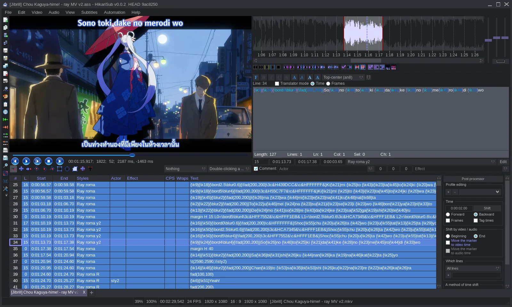
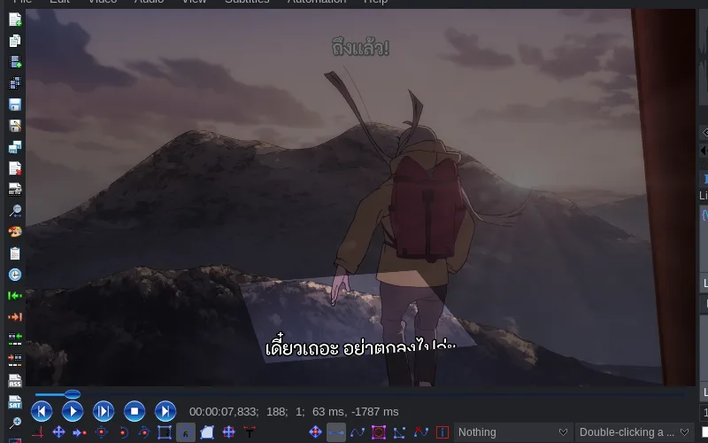
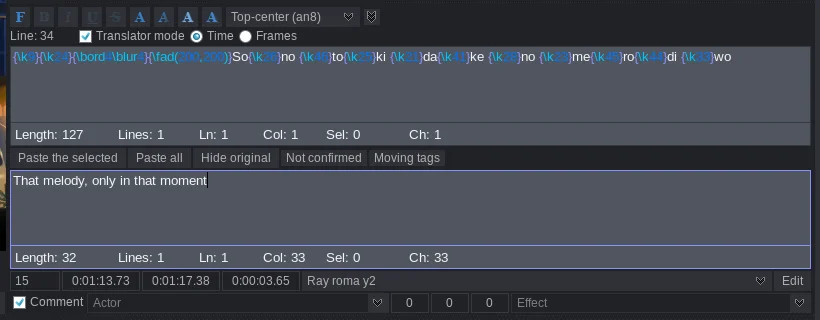
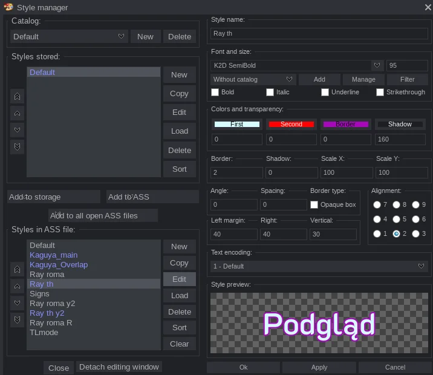
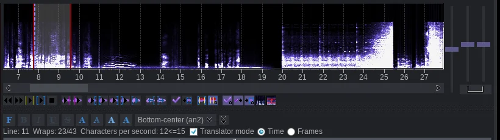

<p align="center">
  
</p>

<h1 align="center">HikariSub legacy</h1>

<p align="center">A subtitle editor and player for everything from quick fixes to full typesetting.</p>

<p align="center"><a href="https://hikarisub.altqx.com">Website and user guide</a></p>


<p align="center"><sub>Subtitles: Jibrill</sub></p>

This is HikariSub legacy, version 0.0.x, built on wxWidgets. It is still maintained. A rewrite in Qt (0.1) is on the [`main`](https://github.com/altqx/hikari/tree/main) branch. Legacy will offer it as an update, and moving is your choice ([ADR-0021](https://github.com/altqx/hikari/blob/main/docs/adr/0021-opt-in-offer-of-the-rewrite-to-legacy.md)).

## Features

<table>
  <tr>
    <td width="50%">
      
      <p>Visual typesetting on the video: position, move, scale, rotation, clips and drawings.</p>
    </td>
    <td width="50%">
      
      <p>Translator mode keeps the original text above your translation.</p>
    </td>
  </tr>
  <tr>
    <td>
      
      <p>A style manager with reusable catalogs and a live preview.</p>
    </td>
    <td>
      
      <p>Waveform or spectrum, with karaoke syllables edited on the audio.</p>
    </td>
  </tr>
</table>
<p align="center"><sub>Subtitles: Jibrill</sub></p>

<details>
<summary><b>Every feature</b></summary>

### Formats

* **Native formats**: opens and saves ASS, SRT, MicroDVD, MPL2 and TMPlayer. SSA is converted to ASS on load.
* **Conversion**: converts between any of the supported formats, with a chosen script resolution when converting to ASS.
* **MKV**: loads subtitle tracks straight from MKV files and extracts their attached fonts.
* **Right-to-left text**: handles RTL text in the grid, the editor and the spellchecker.

### Workspace

* **Tabs**: opens any number of subtitle files in tabs, each with its own video and audio.
* **Subtitle comparison**: compares two tabs side by side by times, styles, selected styles, selections or visible lines, and highlights matching and mismatched lines.
* **Sessions and autosave**: restores the last session or a saved session file. Autosaves keep a configurable number of copies and have their own browser.
* **Layouts**: switches between all panes, video and subtitles, audio and subtitles, video only or subtitles only.
* **History**: undo and redo, a browsable history window, and undo back to the last save.
* **Hotkeys**: every action can be remapped, with separate global, grid, editor, audio and video scopes, and automation macros can have hotkeys too.
* **Themes**: every colour in the interface can be themed. The bundled themes can be copied and edited in the settings.
* **Localisation**: the interface is available in English, Polish, Korean, Thai and Tamil.
* **Windows integration**: registers file associations for subtitle types.

### Subtitle grid

* **Filtering**: hides comments, selected lines or chosen styles, or shows only unconfirmed or untranslated lines, or only lines visible on the current frame. Filters can be inverted and applied automatically on load.
* **Trees**: groups lines into named trees with descriptions that can be selected and copied as a unit.
* **Columns**: any column can be hidden, and a characters-per-second column is available.
* **Sorting**: sorts all or selected lines by start time, end time, style, actor, effect or layer.
* **Line operations**: insert before or after at the video time or frame, duplicate, join (keeping the first or last text), merge with the neighbouring line, swap, and copy or paste individual columns.
* **Splitting**: splits a line at the video time, or into frames, characters, words or line wraps.
* **Select lines**: selects by text or regular expression in any field, then copies, cuts, deletes or moves the matches.
* **Find and replace**: searches with regular expressions in chosen fields, in the current file, in all open tabs, or in every subtitle file in a folder, with a results window.
* **Clean-up**: fixes common minor errors and removes unused styles.

### Editing and translation

* **Editor**: ASS tags, karaoke templates, brackets and misspelled words are highlighted, and there are up to 20 configurable tag buttons.
* **Bulk tagging**: applies tags and changes to many selected lines at once.
* **Translation mode**: shows the original text next to the translation, can show the original on the video, and jumps to the next untranslated or unconfirmed line.
* **Translation alignment**: when pasting a translation over a timed original, lines can be added, deleted or joined on either side until the two match.
* **Confirmation workflow**: lines stay unconfirmed until you commit them, and there are shortcuts to jump between them.
* **Spellchecking**: Hunspell with inline suggestions and a spellcheck dialog, plus a replacer for common mistakes that lists each match for review.
* **Styles**: a style manager with reusable style catalogs, a live preview and font catalogs.
* **Script tools**: resamples subtitles with or without stretching, warns when the script and video resolutions differ, edits ASS file properties, and can hide tags for plain-text reading.

### Timing

* **Time shifting**: shifts by time or frames, forwards or backwards, on all lines, selected lines, lines from the selection onwards, or chosen styles. It can move start times, end times or both, supports profiles, and can stay in sync across tabs.
* **Post-processor**: adds lead-in and lead-out, corrects overlapping or improper end times, extends short gaps, and snaps to keyframes.
* **Keyframes**: loads keyframe files, jumps between keyframes, and snaps start and end times to the nearest one.
* **Quick timing**: makes a line's times continuous with the next or previous line, takes start and end times from the video, and changes the FPS.

### Audio

* **Displays**: waveform or spectrum, with optional speech-frequency enhancement, keyframe and second markers, and a time readout next to the cursor.
* **Playback controls**: plays before or after the markers, the first or last 500 ms, to the end, or the active line, and can follow the audio during playback.
* **Sources**: loads audio files or audio from a video, optionally into RAM, with an audio delay setting, a disk cache, and a blank 2h30m track for timing without audio.
* **Snapping**: snaps to keyframes and to other lines, with linked volume and horizontal stretch sliders.
* **Karaoke**: splits syllables automatically and edits them on the waveform.

### Video

* **Player**: frame-accurate FFMS2 playback with optional GPU colour conversion, DirectShow on Windows and GStreamer on Linux.
* **Subtitle renderers**: libass by default, or on Windows xy-VSFilter or VSFilterMod through CSRI.
* **Zoom**: zooms into the video, including in fullscreen, for precise clips and drawings.
* **Fullscreen player**: chapters, next and previous file, volume, aspect ratio and a progress bar.
* **Frames**: saves a frame as PNG or copies it to the clipboard, with or without subtitles.
* **Line sync**: seeks the video when you click or edit a line, and can play the line afterwards. When to seek and what to play are both configurable.
* **Dummy video**: a placeholder video for typesetting without the real source.

### Visual typesetting

* **Position**: drags `\pos` with an alignment pointer, or places the text inside a drawn rectangle.
* **Movement**: edits `\move` directly, or sets it from two points on different frames.
* **Rotation**: Z and X/Y rotation around `\org`, including an angle taken from two points, and can keep drawings in place.
* **Scaling**: scales by dragging or by drawing a rectangle, optionally keeping proportions.
* **Clips**: rectangular and vector `\clip`/`\iclip` built from lines, B-splines and separate points, with inversion.
* **Vector drawings**: edits `\p` drawings, with a library of reusable ASS drawings.
* **Move all**: moves positions, `\move` points, `\org`, clips and drawings together across lines.
* **All tags (Hydra)**: edits any listed tag visually, with gradients and multiply modes for text and lines.
* **Shifters**: the position shifter and the scale-and-rotation shifter apply one adjustment across many lines.

### Fonts

* **Font collector**: checks that every used font is installed, copies the fonts to a folder, packs them into a ZIP or muxes them into an MKV with mkvmerge.
* **Font sources**: extracts fonts from a loaded MKV and can use an external fonts folder.

### Automation

* **Automation 4**: runs Automation 4 Lua scripts on LuaJIT, ships the Aegisub automation library, and works with [DependencyControl](https://github.com/TypesettingTools/DependencyControl).
* **Script management**: autoloads scripts, maps macro hotkeys, reruns the last script, and has a compatibility mode for older scripts. An installed copy keeps your own scripts in its data folder ([docs/install.md](docs/install.md#where-your-scripts-keep-their-files)).

### Platforms

* **Windows x64**: the full-featured build, including DirectShow, DirectSound and Direct3D 9.
* **Linux**: built on wxGTK and GStreamer.

</details>

## Download

Get the latest release from the [releases page](https://github.com/altqx/hikari/releases):

| System | Download |
| --- | --- |
| Windows 10 (1809) or 11, x64 | `HikariSub-<version>-windows-x64-setup.exe` installer or `.zip` portable |
| Linux x86_64, glibc 2.35 or later | `.AppImage`, `.deb`, `.rpm` or `.tar.gz` portable |

The installer is not code-signed, so Windows SmartScreen may ask you to confirm it. [docs/install.md](docs/install.md) covers each package, the installer's silent switches and its exit codes.

## Updates and privacy

At most once a day, HikariSub asks GitHub whether a newer release is out. The installer, AppImage, deb and rpm then download it, check its SHA-256 and install it when you choose Restart now or quit. Portable copies only tell you. Turn the check off in File > Settings, on the Editor page, under Updates.

<details>
<summary>What is sent and how updates install</summary>

- The check asks `api.github.com` for the list of HikariSub releases when the program starts. If GitHub could not be reached, it asks again at a start an hour later. GitHub sees your IP address and "HikariSub" as the user agent, and nothing about the build.
- Before it installs, the part that installs checks the download again by itself against the release's `SHA256SUMS` on GitHub, so nothing another program put in your download folder runs with administrator rights:
  - On Windows that is the installed HikariSub. An all-users installation starts it through the administrator prompt, only when its folder cannot be changed without administrator rights, and it then runs the installer. If you start HikariSub while that installer runs, it starts when the installer is done.
  - On Linux it is the deb and rpm packages' update helper, which asks for your password through the system's prompt (pkexec) and installs the package only if it is that release's own file.
- An AppImage installs at the next start after that quit, so that a version that cannot start is put back.
- A portable copy (zip or tar.gz) says a new version is out and opens the release page.
- Turning off "Install updates automatically" makes an installed copy only say a new version is out, as a portable copy does. Help > Check for updates checks at any time.

</details>

## Build from source

```bash
git clone --recurse-submodules https://github.com/altqx/hikari.git
```

Windows builds with Visual Studio 2022 or newer from `HikariSub.sln` after `Thirdparty\bootstrap.ps1`. Linux builds with CMake against system packages and a pinned wxWidgets. [docs/build.md](docs/build.md) has the steps and the dependencies for each distribution.

## Why a fork?

HikariSub is a fork of [Kainote](https://github.com/bjakja/Kainote) by Marcin Drob, continued from Kainote commit `6e1bbb15`. My work on Kainote was housekeeping: current dependencies, a new build and CI, and refactoring. That changed the project more than its maintainer wanted, so we parted ways, and HikariSub is where that work continues.

## License

GNU GPL v3, the same as Kainote, see [LICENSE](LICENSE). The original copyright notices are kept in the source.
