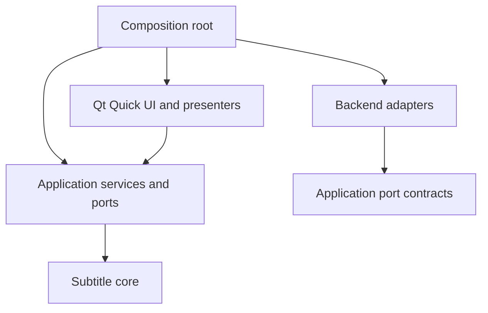

# Hikari-owned application architecture

Accepted foundation, 2026-09-27: [Own the HikariSub Qt application layer](adr/0001-hikari-owned-qt-layer.md). This is HikariSub's module contract. HikariSub legacy's wx tree is reference material; it is not the core or a library to wrap.

## Planned modules

| Module / planned source home | Owns | Boundary |
| --- | --- | --- |
| Core / `src/core` | Authoritative subtitle content, styles, script properties, time/frame values, editing operations and their invariants | Standard C++ value records; no QML/Qt Quick, window, renderer, device, global UI settings or service-container dependency. Qt conversions belong to adapters. |
| Application / `src/application` | Document/session lifetime, editing target and selection, command dispatch, undo transactions, action metadata, settings/shortcuts, workspace/navigation policy and task coordination | Depends on core and explicit backend ports. No duplicated subtitle model in controls and no implicit access through process-wide service lookup. |
| Hikari API / `src/api` | Typed, versioned operations over the application for plugins, AI tools, MCP and nodes, with JSON Schemas and host ports | Depends on application and core; no Qt. The composition root implements its host ports. See [Hikari API](api.md). |
| Plugins / `src/plugins` | The `.hikariplugin` manifest and its schema, package checks, `plugins.json` and the installer with key pinning | Depends on the Hikari API (JSON and the schema validator) and minisign; no Qt. The composition root unzips packages and owns the manager. Each running plugin is a `hikari-plugin-helper` (`src/helpers/plugin`, a restricted LuaJIT state) that `PluginProcess` in the backends supervises. See [Plugins](plugins.md). |
| JSON / `src/json` | The JSON value, its parser and writer (`hikari::json::Json`) | Standard C++ only, so the application layer and the Hikari API share it; `hikari::api::Json` is the same type. |
| Minisign / `src/minisign` | Verifying minisign signatures (`ED` and `Ed`, key id, trusted comment) | libsodium only; no Qt and no other module, so the update check can link it without the plugins. |
| Backend adapters / `src/backends` | FFMS2/libass integration, audio/general playback, automation runtime, font/file/platform services and their resource lifetime | Implement the ports consumed by application services. Backend-specific handles stay inside their adapters. Renderer, A/V clock and thread contracts are separate decisions. |
| Qt Quick UI / `src/ui` | QML shell, reusable controls, panels, model adapters/presenters, focus and accessibility representation | Observes application state and submits commands. It does not become another authoritative document store or make native backend calls from delegates. |
| AI sidecar / `src/ai-sidecar` | Every model call, the agent loop, prompt caching and the MCP client, in TypeScript on Bun | A separate process the app starts. It runs in an OS sandbox with no network and no keys, reaches documents only through `_hikari/api.call` into the Hikari API, and sends its requests out through Qt. See [AI](#ai). |
| Composition root / `src/app` | Process startup, explicit service construction, Qt engine setup, platform adapter selection and orderly shutdown | Wires and owns dependencies once. It does not host document algorithms. |

The names above describe the intended new tree. The CMake target graph and dependency packages are settled by [Choose the dependency and build strategy for the stateless CMake build](https://github.com/altqx/hikari/issues/24); creating these production modules is later implementation work.

The adapter arrow denotes implementation of port contracts, not an application dependency on a concrete adapter. Runtime callbacks return through the specified port and application coordination path.

## AI

[ADR 0026](adr/0026-hikari-ai-runs-in-a-typescript-sidecar-on-bun.md) splits Hikari AI in two:

- **The sidecar** (`src/ai-sidecar`, TypeScript on Bun 1.4) makes the provider requests and runs the agent loop. It is one executable per platform, downloaded on its own and never part of the packages.
- **Qt** keeps the UI, the Hikari API, the staged review, the AI settings and the keys (QtKeychain). It also makes the sidecar's network requests and starts its agent CLIs ([ADR 0029](adr/0029-the-ai-sidecar-runs-in-an-os-sandbox.md)).

The pieces in C++:

- **`AiFeatures`** (`src/app/ai_features.*`) is the only place that builds AI objects. It reads `ai.off`, the "Turn off all AI features" switch, before anything else. With it on, no key store, config store, `Providers`, `AiRequests` or sidecar host exists, so nothing reads the keychain, downloads, starts or listens. Turning the switch on builds them on demand; turning it off destroys them and stops the sidecar. [Settings › AI](ai-settings.md) (`AiSettings`) works only through what it built.
- **`AiSidecarHost`** (`src/backends/ai_sidecar_host.*`) starts the sidecar on the first AI action once a provider exists, never at startup or when Settings opens. It starts it with an allowlisted environment (no `*_API_KEY`, `*_BASE_URL`, `ANTHROPIC_*`, `OPENAI_*`, `GEMINI_*`, `GOOGLE_*`, `OTEL_*` or `NODE_OPTIONS`), in `<user folder>/ai/work`, in its own process group on Linux and a kill-on-close job object on Windows. Shutdown closes stdin, waits 3 s, then kills the tree.
  - It starts the sidecar under a `sandbox::Profile` from `hikari_sandbox` (`src/backends/sandbox*`): Landlock and seccomp on Linux, an AppContainer on Windows. The sidecar may read its install folder and write only its work folder, and it has no network. `sandboxCoverage()` says what didn't apply on this system.
  - `handle(method, handler)` lets other objects answer the sidecar's requests.
- **`HttpRelay`** (`src/backends/ai_http_relay.*`) answers `_hikari/http.request`. It sends the request only to a known target (today a provider's base URL), puts the keychain key where the request has the `hikari-key` placeholder, and streams the answer back with the key masked.
- **`AgentBroker`** (`src/backends/ai_agent_broker.*`) answers `_hikari/agent.*`. It starts the `claude` or `codex` Qt found on `PATH`, each in its own sandbox, checks Claude's arguments, guards Codex's JSON-RPC, and relays their stdio.
- **`AiMcp`** (`src/app/ai_mcp.*`) runs the [MCP server](ai-mcp.md) while AI is on and `ai.mcp.server` is on. It starts the sidecar on the first MCP message, with or without a provider.
- **`AiSidecarDownload`** (`src/backends/ai_sidecar_download.*`) fetches `hikari-ai-<version>-<platform>.gz` from the app's own release into `<user folder>/ai/sidecar/<version>/`. It checks the size and SHA-256 that release's `hikarisub-update.json` gives, and deletes a file that fails.

**The link** is JSON-RPC 2.0, one message per line on the sidecar's stdin and stdout, with requests both ways:

- `initialize` carries the protocol major (`kSidecarProtocolVersion`, 1), HA1's `kApiVersion` and the build id (`<version>+<commit>`). Qt refuses a sidecar whose answer differs, and it isn't restarted until it is downloaded again.
- `$/cancel_request {requestId}` cancels a request, which still gets exactly one response, with code -32800.
- `_hikari/api.call {operation, params}` runs `Api::call` under the sidecar's `Caller`. An HA1 error comes back as code -32000, with HA1's code in `data.code`.
- `_hikari/tools.list` and `_hikari/tools.call` list and run Hikari's AI tools, which the sidecar builds from HA1's operations ([AI tools](ai-tools.md)).
- `_hikari/http.request {stream, target, method, url, headers, body}` is every request the sidecar sends out. Qt answers with `_hikari/http.response` and `_hikari/http.data` notifications, then `{}`.
- `_hikari/agent.start {process, agent, args, env}`, `.write`, `.closeInput` and `.kill` run an agent CLI through Qt, which sends `_hikari/agent.output` and `_hikari/agent.exit` back.
- `_hikari/mcp.message` and `_hikari/mcp.closed` relay HikariSub's MCP server: Qt listens, the sidecar speaks MCP, and an `_hikari/api.call` marked `mcp` runs as that connection's caller ([MCP server](ai-mcp.md)).
- The limits are `HelperHost`'s: 64 outstanding requests, 16 MiB outstanding and 64 MiB per message.

The ACP session methods and the other `_hikari/*` methods in the ADR are declared in `src/ai-sidecar/src/protocol.ts`. Until their cards land they answer "not implemented".

**Crashes.** An exit, a stdout line that isn't JSON-RPC, or no `initialize` answer within 10 s counts as a crash. Requests in flight fail with `SidecarLost`, and the next request restarts the sidecar after a backoff that doubles from 0.5 s. After three crashes in a minute the host stops and keeps the newest 64 KiB of stderr to show.

## State and command ownership

Each open document has one authoritative content state. A UI projection can cache presentation data, but writes pass through an application command and the core's invariants. The accepted [document model](document-model.md) uses ordered source-preserving records and stable Line IDs through edits and undo; IDs are not serialized ASS row numbers. [Time semantics](time-semantics.md) defines distinct document times, deltas, frame indices and rational media timestamps.

An action has a stable identity, user-facing metadata, enabled state and explicit scope. Menus, toolbar buttons, shortcuts and automation entry points route through the same command boundary where they represent the same operation. Focus selects an input context; it must not silently turn a protected comparison reference into the editing target. The shortcut-conflict policy and complete legacy action mapping remain settings/hotkey design work.

Application services own document transactions and undo history. Native text input may own an in-progress draft, but it must reconcile with document commands through a specified commit/cancel boundary. The [ASS editor prototype](https://github.com/altqx/hikari/issues/28) does not yet settle that boundary. Mutating Lua macros and bulk timing/style operations must eventually participate in the same document transaction policy.

Workers return results tagged to their request/document revision; the application decides whether they are still applicable before updating state. Each backend contract must specify cancellation, errors, resource ownership, callback thread and shutdown ordering. This establishes the required contract fields, not a chosen worker pool, threading framework or A/V clock.

The accepted [backend contract](backends.md) now supplies the value/capability/generation, owned-buffer and native-owner boundaries, including isolated FFMS2 qualification first and distinct decode/presentation/device-drain evidence. It refines this foundation without approving the still-pending draft, history, lifecycle or Lua API policies.

## Application services HikariSub must provide

- Actions and shortcuts: discoverable commands, contextual routing, disabled reasons, localisation and accessible labels.
- Navigation: predictable panel traversal and focus restoration, native input/IME ownership, and semantic representations for custom views.
- Workspaces: one shared application layout, movable/floating panels, follow/pin tool targets and optional protected comparison, as [accepted in the workspace review](ux/workspaces.md). Classic menus/local controls and optional task presets are accepted; the [KDDockWidgets adapter/persistence contract](docking.md) is accepted; native qualification and detailed surface behavior remain required.
- Appearance: reusable Qt Quick Controls styled through the [accepted Compact Studio visual language](ux/visual-language.md). UI appearance never changes ASS style data.
- Settings: explicit scopes, stable persisted identities and a one-shot legacy importer. Legacy theme files and theme selection are excluded from import.
- Tasks/dialogs: owned progress/cancellation and errors; synchronous script-dialog semantics are implemented without allowing a worker to manipulate QML directly.
- Localisation: TS authoring and QM runtime with unchanged script-facing lookup behavior, as specified in [localisation](localisation.md).

These services are owned modules with explicit construction and narrow interfaces. The foundation does not require a general IoC container or adoption of Muse's module/resource conventions. HikariSub plugins, a LuaJIT format on the Hikari API, are decided in [ADR 0022](adr/0022-hikarisub-plugins.md).

## Reuse and platform policy

Use Qt Quick Controls as the ordinary input/control foundation. Share HikariSub-specific semantics and visual tokens in the UI module rather than cloning controls separately in each panel. A custom-drawn surface must supply the keyboard and accessibility semantics that an ordinary control would otherwise provide.

FFMS2 and libass remain required by the map. Cross-platform adapters are the default; optional Windows-only backend adapters may be selected behind the same application boundary. Those backend extensions are not plugins: [ADR 0022](adr/0022-hikarisub-plugins.md) replaces the map's exclusion of a general plugin ecosystem with HikariSub plugins and leaves backend composition as it is. Do not expose platform-specific types to the core or make a later macOS adapter impossible.

No Muse module is imported by default. Selective future reuse needs a recorded source revision, licence/notices, dependency closure and maintenance owner; UI similarity is not itself a reason to adopt framework code. The [accepted docking contract](docking.md) selects pinned KDDockWidgets QtQuick behind Hikari’s layout adapter; it does not import a separate application framework.

The accepted [platform policy](platform-policy.md) started from Qt 6.11.2, adopted 6.12.0 after its release and qualification (#527), and advances Qt with explicit Windows 10 retirement later. The [compatibility contract](compatibility.md) requires named approval for behavioral departures; an individually approved defect fix becomes the default.

## Open design and verification

The document and time contracts are accepted; command/undo granularity, session/recovery and scheduler contracts remain open. The [build mechanism](build.md), [media/audio direction](media.md), [performance gates](performance.md) and [distribution policy](distribution.md) are accepted with native feasibility and release evidence still required. The [isolated automation boundary](automation.md) and [verified font contract](fonts.md) retain explicit detailed-design obligations. Unlisted legacy defects still require named disposition.

Implementation must verify dependency direction, command/selection behavior through filtering and undo, late/cancelled worker results, script transactions, native focus/IME/screen-reader behavior and lifecycle cleanup. There is no implementation or benchmark pass attached to this ADR; the completed research and throwaway prototypes are evidence for planning.
