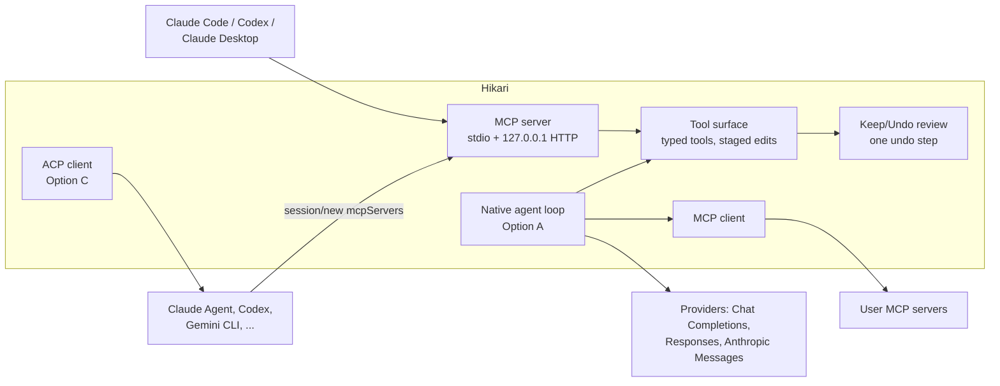

# Hikari AI integration: agent UX, providers, tools and safety

> **Decided 2026-10-28.** The owner settled the open questions at the end of this note in a grilling session. The decisions are in the wave-8 tracking issue [#410](https://github.com/altqx/hikari/issues/410) (cards AI0–AI17, #428–#445); where they differ from a recommendation here, #410 wins.

This is a reference for a post-wave-7 feature the owner asked for: an AI agent inside HikariSub "like in
Zed editor or VS Code Copilot" that can do almost everything a user can (typesetting with frame
inspection, Honya-style translation, automation, plugins, karaoke and karaoke effects, every panel and
piece of state, skills, MCP, the node editor), with OpenRouter, "login with OpenAI", the Anthropic Agent
SDK, the OpenAI and Anthropic platform endpoints, and other OpenAI-style endpoints as providers.

Sources read:

- HikariSub `qt` at `6c0d80daa` (2026-10-27). Paths such as `docs/qt/automation.md:11` refer to that
  commit.
- Honya at `83b6209` (`/home/altq/Work/honya-cli`). Paths such as `honya:src/agents/prompts.rs:44` refer
  to that commit.
- Vendor documentation, specifications and terms. All web pages were fetched on **2026-10-28**. Where a
  page did not say something, this note says so rather than filling the gap.
- GitHub repositories read through the API on 2026-10-28: TypesettingTools/Aegisub-Motion,
  arch1t3cht/Aegisub-Scripts, unanimated/luaegisub, TypesettingTools/ASSFoundation, m-bain/whisperX,
  MontrealCorpusTools/Montreal-Forced-Aligner and mfa-models, frankosterfeld/qtkeychain,
  agentclientprotocol/agent-client-protocol and registry.

Terms follow [CONTEXT.md](../../CONTEXT.md): Document, Line, Editing target, Protected reference, Tool
target, Translation mode, Original text, Translated text, Unconfirmed, Automation macro. "Agent" means a
model running a tool loop. "Tool surface" means the set of typed operations Hikari exposes to an agent,
whoever runs the loop.

## 0. Summary

- **The UX converges.** Zed, VS Code, Cursor and JetBrains share one shape: a dockable chat panel with
  threads, an `@`/`#` context picker, a model picker, streamed tool calls, per-tool approval
  (allow once / for the session / always; deny rules first), edits applied at once but shown as pending
  hunks to keep or undo, and checkpoints that roll back a whole turn. Profiles or custom agents choose
  which tools are offered; permissions decide whether a call runs unasked. These are separate layers in
  both Zed and VS Code.
- **External agents are a second axis.** Zed and JetBrains host agents they do not run, over the Agent
  Client Protocol (ACP, JSON-RPC over stdio). The external agent owns its model, auth and billing; the
  editor passes its MCP servers to it in `session/new`. Claude Agent (built on the Claude Agent SDK),
  Codex, Gemini CLI and about 50 others are in the ACP registry.
- **Providers: plain HTTP + SSE is the norm for C++.** Neither OpenAI nor Anthropic lists a C++ SDK, MCP
  has no official C++ SDK in any tier, and ACP's official libraries are Kotlin, Java, Python, Rust and
  TypeScript. Hikari already links Qt Network (`src/app/CMakeLists.txt:24`) and curl (`vcpkg.json`). Three
  wire shapes cover the requested providers: Chat Completions (OpenRouter, Ollama, LM Studio, vLLM, any
  "OpenAI-compatible" endpoint), the OpenAI Responses API (OpenAI platform and ChatGPT-plan usage), and the
  Anthropic Messages API.
- **"Login with OpenAI" now exists officially.** OpenAI's *Sign in with ChatGPT* (SIWC) lets an
  open-source or local app register a client on first sign-in (`client_id=dynamic_agent_client`, PKCE,
  loopback on `127.0.0.1`) and spend the user's ChatGPT plan on `POST https://api.openai.com/v1/responses`
  with `store:false, stream:true`. Paid or hosted apps need a client ID from a waitlist. OpenAI says not
  to point such tokens at ChatGPT's `backend-api`, which is what Honya does today with the Codex CLI's
  client ID.
- **Claude subscription login is not available to Hikari.** Anthropic "does not permit third-party
  developers to offer Claude.ai login into their own applications", including agents built on the Agent
  SDK; developers use API keys or a cloud provider. What stays allowed is an end user signing in to the
  unmodified Claude Code binary with their own subscription.
- **The Claude Agent SDK is a library that runs the Claude Code binary**, in Node 18.14+ or Python 3.10+,
  with a bundled native binary. Hikari can reach it without embedding Node through the ACP adapter
  `claude-agent-acp` ("Use Claude Agent SDK from any ACP client").
- **MCP's current revision is 2026-07-28** and it is stateless: no `initialize` handshake, per-request
  `_meta` version, Streamable HTTP without sessions or a GET stream, server-to-client requests folded into
  results (MRTR). Sampling, Roots and Logging are deprecated. A Hikari MCP *server* must validate
  `Origin`, bind to `127.0.0.1` and authenticate; a Hikari MCP *client* should speak 2026-07-28 and fall
  back to `initialize` for older servers.
- **Hikari's surface is large: about 280 commands and 13 panels.** VS Code refuses more than 128 tools per
  request; Anthropic says tool choice degrades past 30–50 tools and offers server-side tool search with
  `defer_loading` (up to 10,000 deferred tools); OpenAI offers `tool_search` with namespaces. Expose ~20
  typed domain tools plus a searchable command catalog, not one tool per command.
- **Hikari already has the parts frame inspection needs.** `snapshotImage` composes a frame with or
  without the libass overlay (`video_snapshot.h:34`), the renderer reports where it drew
  (`subtitle_render.h:101`), automation's `get_frame` returns pixels with subtitles
  (`docs/qt/compatibility-decisions.md:210`), and VT3's perspective maths converts between tags and quads
  (`visual_perspective.h:78-86`). A 1920×1080 frame costs 2,691 visual tokens on Claude's high-resolution
  tier (about $0.011 on Opus 5.5 at $4/M) and 258 tokens per frame on Gemini video; crops cost far less.
- **Vision gives approximate coordinates.** Anthropic says Claude's localization outputs "are approximate".
  Precise typesetting should stay with deterministic solvers (VT3's `quadToTransform`, the Hydra engine,
  tracking data as Aegisub-Motion and arch1t3cht's PerspectiveMotion consume it), with the model proposing
  and a render–compare loop checking.
- **Honya's pipeline maps onto Translation mode.** Per-chunk reference scoping, translator → deterministic
  audit → reviewer retries, an orchestrator that persists glossary/character discoveries with protected
  locks, a whole-chapter coherence sweep and `NeedsReview` instead of failure. In Hikari the unit is a run of
  Lines, the Translated text field is the output, tag runs are carried by TM1's rules, and Unconfirmed
  is the review-needed flag.
- **Safety is mostly approval and staging.** Subtitle text and scripts are untrusted input (indirect prompt
  injection). Hikari's macro transaction already stages edits against a revision and applies them as one
  undo step (`macro_transaction.h:1-6`), but its Lua helper "is not a security sandbox"
  (`docs/qt/automation.md:11`), so AI-written Lua needs explicit approval. Keys belong in the OS keychain
  (QtKeychain has a `qtkeychain-qt6` vcpkg port).
- **Recommendation:** build one Hikari tool surface first, serve it to external agents over MCP, then add
  a native C++ agent loop with the three wire adapters and a Keep/Undo review on the Document, then an ACP
  client for external agents (which is also how "the Anthropic Agent SDK" and Claude subscriptions reach
  Hikari legitimately). See §8–§10.

## 1. Agent UX prior art

### 1.1 Zed

- **Agent Panel.** Threads (new, parallel, a threads sidebar, history, generated titles), a model selector
  with favourites, `@`-mentions for "files, directories, symbols, previous threads, skills, diagnostics,
  branch diffs, and URLs", selection and images as context, a token count near the profile selector, auto
  and manual `/compact`, and queued messages with **Steer** (delivered at the agent's next step) and
  **Send Now** ([Agent Panel]).
- **Review.** The panel lists changed files and line counts; **Review Changes** opens a multibuffer where
  you can "accept or reject each individual change hunk, or the whole set of changes". **Restore
  Checkpoint** rolls the project back to before a message, even after an interrupted edit ([Agent Panel]).
- **Profiles vs permissions.** Built-in profiles Write ("reading, editing, and running commands"), Ask
  ("read-only codebase questions") and Minimal ("no project tools"); custom profiles list tools, MCP servers
  and a default model. Profiles "do not decide whether a tool call is allowed automatically"
  ([Agent Profiles]). Permissions live in `agent.tool_permissions`: a default of `confirm`/`allow`/`deny`,
  per-tool defaults, and `always_deny` > `always_confirm` > `always_allow` regex rules matched against the
  command, path or URL; MCP tools are keyed `mcp:<server>:<tool>`; hard-coded rules block recursive deletion
  of `/`, `~` and the like; the prompt offers "Allow once", "Always for <tool>" and "Always for <pattern>"
  ([Tool Permissions]).
- **Inline Assistant.** `ctrl-enter` sends the selection or line to a model and replaces it; the same prompt
  runs at every cursor; `inline_alternatives` generates outputs from several models to cycle between.
  External agents cannot serve it ([Inline Assistant]).
- **Skills.** Folders with `SKILL.md` (`name` ≤ 64 lowercase chars, `description` ≤ 1024) under
  `~/.agents/skills/` or `<worktree>/.agents/skills/`; "the agent sees only the name and description until
  it activates a skill"; a 50 KB catalog budget; the agent calls a `skill` tool, or the user types `/` or
  `@skill`; user-installed skills ask permission like other tools ([Zed Skills]). Reusable rules "have been
  replaced by Skills"; always-on instructions include `AGENTS.md` ([Agent Settings]).
- **MCP.** `context_servers` with `command/args/env` (local) or `url/headers` (remote, with MCP OAuth when
  no header is set). "Zed currently supports MCP's Tools and Prompts features"; it handles
  `notifications/tools/list_changed`. Zed forwards its MCP servers to external agents over ACP ([Zed MCP]).
- **External agents.** Installed from the ACP Registry; they "usually own [their] own runtime, auth, model
  selection, tools, and native configuration". Claude Agent handles its own auth and billing (`/login`,
  "an API key or with Claude Code where supported"); Codex "may support ChatGPT login, Codex API keys,
  OpenAI API keys"; Zed profiles and skills do not apply to them ([Zed External Agents]).

### 1.2 Agent Client Protocol

- Standardizes editor ↔ agent communication like LSP; local agents "run as sub-processes of the code
  editor, communicating via JSON-RPC over stdio"; it "re-uses the JSON representations used in MCP where
  possible" and adds types such as diffs ([ACP intro]).
- Agent methods: `initialize`, `authenticate`, `session/new`, `session/prompt`, optional `session/load`,
  `session/set_mode`, `logout`; notification `session/cancel`. Client methods: `session/request_permission`
  (baseline), optional `fs/read_text_file`, `fs/write_text_file`, `terminal/*`, `elicitation/create`;
  notification `session/update` (message chunks, tool calls, plans, modes, compactions) ([ACP overview]).
- `session/new` carries `mcpServers`: stdio (`command` absolute path, `args`, `env`) is mandatory for
  agents, HTTP optional (`mcpCapabilities.http`), SSE deprecated; agents should connect to all of them, and
  "Clients can also expose their own tools to the model by including their own MCP server" ([ACP session
  setup]).
- Official libraries: Kotlin, Java, Python, Rust, TypeScript; no C++ ([ACP repo README]). The registry holds
  `claude-acp`, `codex-acp`, `gemini`, `github-copilot`, `junie`, `opencode`, `goose`, `cursor` and others
  ([ACP registry]). `claude-agent-acp` (formerly `claude-code-acp`, Apache-2.0) is "Use Claude Agent SDK
  from any ACP client".

Because the client implements `fs/read_text_file` and `fs/write_text_file`, a Hikari ACP client could
answer them for virtual Document paths and route an external agent's writes into the same review as its
own agent's. ACP does not require agents to use those methods instead of their own file tools; that has to
be verified per agent.

### 1.3 VS Code Copilot

- **Tools.** Built-in, MCP and extension tools; the agent picks from enabled tools by itself; `#` references
  a tool or context item; "A chat request can have a maximum of 128 tools enabled at a time", with
  `github.copilot.chat.virtualTools.threshold` grouping tools to activate on demand. User tool sets are
  deprecated in favour of custom agents ([VS Code tools]).
- **Language Model Tools API.** `contributes.languageModelTools` with `name`, `displayName`,
  `toolReferenceName`, `modelDescription`, `inputSchema` and `when`; `vscode.lm.registerTool`;
  `prepareInvocation` returns an `invocationMessage` and confirmation text; "A generic confirmation dialog
  will always be shown for tools from extensions"; errors should be thrown "with a message that makes sense
  to the LLM" ([LM Tools API]).
- **Approvals.** Separate settings for permission level (`chat.permissions.default`: manual, allow all,
  autopilot), tool auto-approval eligibility, URLs, terminal commands (per-command rules, `rm`/`curl`/…
  denied by default, every subcommand must match) and sandboxing; a prompt approves once or for the
  session, workspace or always; the security guide recommends session-level grants ([VS Code approvals],
  search-result excerpts of that page).
- **Keep/Undo.** Edits are written to disk at once and marked pending; per-file and per-hunk **Keep** and
  **Undo**; `chat.editing.autoAcceptDelay` keeps them after a delay; checkpoints snapshot files before each
  request (**Restore Checkpoint**, **Redo**, **Fork Conversation**); restores "don't reverse completed
  terminal commands, network requests"; editing an earlier request reverts its and later changes. The
  Copilot, Claude and Codex *harness* sessions skip the pending state and rely on checkpoints or Git
  ([VS Code review edits]).
- **Custom agents** (formerly chat modes): `.agent.md` with `name`, `description`, `tools` (only those are
  available), `model` and `handoffs` buttons, in `.github/agents`, `.claude/agents` or user folders
  ([VS Code custom agents]). **Instructions:** `.github/copilot-instructions.md`, `*.instructions.md` with
  `applyTo` globs, `AGENTS.md`; "Applicable instruction sources are additive" ([VS Code instructions]).
- **MCP:** stdio, Streamable HTTP and legacy SSE; tools, prompts, resources, elicitation, sampling, OAuth;
  `.vscode/mcp.json` ([VS Code MCP guide], search excerpt).

### 1.4 Cursor and JetBrains, briefly

- **Cursor:** agent in a side pane with "no limit on the number of tool calls"; tools for search, web,
  rules, reading (images on vision models), editing, shell, browser, image generation and asking questions;
  automatic checkpoints restorable from the timeline ("reverts files only"); queued messages and steering;
  a post-run "Find Issues" review ([Cursor agent], [Cursor review]).
- **JetBrains AI Assistant:** Chat and Agents modes; a model selector over the JetBrains service, a
  third-party provider with your key, or local models; attachments for files, symbols, images and commits;
  agents' multi-file changes can be kept or rolled back per file ([JetBrains chat]). It hosts ACP agents
  from the registry, downloading "a Node.js or Python runtime if required", or from `~/.jetbrains/acp.json`;
  it can expose its own MCP server to them (`use_idea_mcp`); built-in agents are Junie, Claude Agent, Codex
  and GitHub Copilot ([JetBrains ACP], search excerpt).

### 1.5 The patterns, applied to Hikari

| Pattern | Prior art | Hikari mapping |
| --- | --- | --- |
| Chat panel with threads | Zed panel, VS Code Chat view, JetBrains AI Chat | A dock panel of the WorkspaceLayout adapter like the 13 in `src/ui/workspace_layout.cpp:129-136`; threads per Document tab or per Session |
| Inline action | Zed Inline Assistant, multi-cursor | A Line editor / Grid action on the selected Lines ("Translate", "Fix timing", "Restyle"), the same prompt on each Line |
| Context attachments | `@file`, `@selection`, images, diagnostics | `@line`, `@selection`, `@style`, `@frame` (current frame with/without subtitles), `@audio` (range), `@glossary`, `@log` |
| Model picker | Zed per-thread, Zed inline alternatives, Honya per-role ModelSet | Per thread plus per role (translator, reviewer, vision) |
| Tool approval | Zed deny > confirm > allow; VS Code once/session/workspace/always | Reads unasked; Document edits staged (no prompt); file, Lua, network and MCP calls prompt |
| Diff/review | Zed hunks, VS Code Keep/Undo, JetBrains per file | Per-Line Keep/Undo over a staged change set, drawn like R1's comparison (`subtitle_comparison.h:1-12`) |
| Undo | Checkpoints per request; restores do not undo external effects | Accepted set = one undo step (the macro transaction rule, `docs/qt/automation.md:85`); a checkpoint is the Document revision before the turn |
| Profiles | Write/Ask/Minimal; custom agents with tool lists | Ask, Edit, Agent; task presets (Typeset, Translate, Karaoke) carrying tools and skills |

## 2. Providers and auth

### 2.1 OpenRouter

- **API.** `POST https://openrouter.ai/api/v1/chat/completions`, "very similar to the OpenAI Chat API";
  `stream: true` gives SSE "for all models", with occasional comment payloads to ignore; `tools` and
  `tool_choice` in OpenAI form, passed through or transformed; images as `image_url` (URL or base64) in user
  messages; usage (tokens, `cost`, `is_byok`, `cost_details`) once in the final stream chunk; attribution via
  `HTTP-Referer` and `X-OpenRouter-Title` (`X-Title` accepted) ([OpenRouter API]).
- **Routing.** A `provider` object: `order`, `allow_fallbacks`, `require_parameters`,
  `data_collection: "deny"`, `zdr`, `only`, `ignore`, `sort` (price/throughput/latency) and `max_price`
  ([OpenRouter routing]). `data_collection` and `zdr` are the privacy levers worth surfacing.
- **BYOK.** Provider keys stored encrypted at OpenRouter; 5 % of the normal price charged to credits after a
  plan allowance ("Pay-as-you-go includes $25,000 per month"); prioritized and fallback keys
  ([OpenRouter BYOK]).
- **OAuth PKCE.** `https://openrouter.ai/auth?callback_url=…&code_challenge=…&code_challenge_method=S256`,
  then `POST /api/v1/auth/keys` with `code` and `code_verifier` returns a user-controlled key billed to the
  user; "Localhost callbacks are supported on any port" (such apps stay out of rankings); a headless mode
  shows the code for pasting; codes expire after 10 minutes ([OpenRouter PKCE]). This is the cleanest
  "sign in" for a desktop app.

### 2.2 "Login with OpenAI"

- **Codex.** Codex offers "Sign in with ChatGPT for subscription access" or an API key; it caches tokens in
  plaintext `~/.codex/auth.json` or the OS credential store (`cli_auth_credentials_store`); a device-code
  flow exists in beta; "Treat `~/.codex/auth.json` like a password" ([Codex auth]).
- **Reuse policy.** "If you've built a local or open-source application using Codex app-server
  authentication, you can continue using it", with migration to SIWC recommended; "App-server
  authentication has never been permitted for commercial or hosted services" ([Codex app-server], the
  page's "Auth endpoints" section).
- **Sign in with ChatGPT (plan usage).** An optional capability that lets an app use the user's ChatGPT plan
  "for eligible Responses API requests" without access to their conversations. The documented flow covers
  "open-source and locally hosted apps"; paid or remotely hosted apps use an interest form
  ([SIWC overview]), and client IDs are "currently offered to a select group of commercial partners"
  ([SIWC client ID]).
  - Sign-in: system browser to `https://auth.openai.com/api/accounts/authorize` with `response_type=code`,
    `resource=https://api.openai.com/v1`, S256 PKCE, fresh `state` and `nonce`; first sign-in sends
    `client_id=dynamic_agent_client` and an opaque `ext_agent_host_id`, and the callback returns an issued
    `oaiapp_…` ID to keep; no client secret; scopes `openid profile email` and
    `offline_access resource.invoke chatgpt.tokens.use.direct`; check the granted scopes for
    `chatgpt.tokens.use.direct`; callback on `http://127.0.0.1:<port>/auth/callback` ("Do not substitute
    with `localhost`"); token at `https://auth.openai.com/api/accounts/oauth/token`; validate the ID token
    against OpenAI's JWKS; store credentials owner-only ([SIWC sign-in]).
  - Inference: `Authorization: Bearer <token>` to `POST https://api.openai.com/v1/responses`; "do not point
    it at ChatGPT's `backend-api` endpoints"; models from `GET /v1/models` filtered to `visibility == "list"`;
    `store:false`, `stream:true`; success only on `response.completed`; usage-limit errors
    `subscription_sharing_usage_limit_exceeded` / `…_unavailable` may arrive mid-stream ([SIWC models]).
  - Limits: no `previous_response_id` over HTTP (send the history); no `temperature`, `max_output_tokens`,
    `metadata` and others; function/custom tools in namespaces are supported; image generation, file search,
    hosted MCP and Responses `tool_search` are not; "Text, images, and files are supported when the selected
    model accepts them"; audio/video input is not ([SIWC limitations]).
- **Honya today** reuses the Codex CLI's OAuth client (`honya:src/codex/auth.rs:16-20`, client ID
  `app_EMoamEEZ73f0CkXaXp7hrann`, redirect `localhost:1455`) and calls
  `https://chatgpt.com/backend-api/codex/responses` with `originator: codex_cli_rs`
  (`honya:src/llm/codex.rs:22`, `:83`). SIWC's documentation names that endpoint family as the one not to
  use. Hikari should implement SIWC instead, and Honya (and Dexrip, patterned on it) should migrate.

### 2.3 Anthropic

- **Messages API** with `image` blocks (base64, URL or Files API `file_id`) ([Claude vision]). Anthropic's
  client SDK examples cover Python, TypeScript, C#, Go, Java, PHP and Ruby; no C++.
- **Claude Agent SDK.** "A library that runs the Claude Code binary" with built-in tools, hooks, subagents,
  MCP, permissions, sessions, skills and plugins, in Python and TypeScript; other languages can run the CLI
  with `-p --output-format json` ([Agent SDK overview]). Prerequisites: "Node.js 18.14+ or Python 3.10+";
  both SDKs bundle a native Claude Code binary; auth by `ANTHROPIC_API_KEY`, Bedrock, Claude Platform on
  AWS, Google Cloud or Microsoft Foundry ([Agent SDK quickstart]). Custom tools are in-process MCP servers
  (`createSdkMcpServer`), named `mcp__<server>__<tool>`, may return images and `structuredContent`, carry
  `readOnlyHint`/`destructiveHint` annotations, and are deferred by tool search by default
  ([Agent SDK custom tools]). Use is governed by the Commercial Terms; products may say "Claude Agent" or
  "Powered by Claude" but not "Claude Code" ([Agent SDK overview]).
- **Subscription login.** "Unless previously approved, Anthropic does not allow third party developers to
  offer claude.ai login or rate limits for their products, including agents built on the Claude Agent SDK"
  ([Agent SDK overview]). The legal page is stricter: OAuth is "intended exclusively for purchasers of …
  subscription plans" for Claude Code and native Anthropic apps; developers "should use API key
  authentication"; "Anthropic does not permit third-party developers to offer Claude.ai login into their own
  applications, or to route requests through Free, Pro, or Max plan credentials on behalf of their users";
  developers "may not collect, store, or intermediate Claude.ai credentials or session tokens". It "does not
  … prevent an end user from signing in to the unmodified Claude Code binary with their own Claude
  subscription" ([Claude Code legal]).
- **Hosting from C++/Qt.** Options, from lightest: (a) Messages API over HTTP+SSE from Hikari itself;
  (b) the Claude Code CLI as a subprocess in headless JSON mode; (c) a Node/Python sidecar on the Agent SDK
  that serves Hikari's tools as an in-process MCP server and speaks to Hikari over a local channel; (d) the
  `claude-agent-acp` adapter launched as an ACP agent. (c) means shipping a Node or Python runtime and the
  SDK's bundled binary under Anthropic's Commercial Terms inside a GPL-3.0 package
  (`gh repo view altqx/hikari`: GPL-3.0); (d) leaves installation to the user or an ACP-registry download,
  as JetBrains does.

### 2.4 OpenAI platform: Responses vs Chat Completions

"While Chat Completions remains supported, Responses is recommended for all new projects." Responses
streams typed events (`response.output_text.delta`, `response.function_call_arguments.delta`,
`response.completed`), tags functions internally and tries strict schemas by default, correlates calls and
outputs by `call_id`, stores responses unless `store: false`, and expects stateless callers to replay
reasoning items (`encrypted_content`). "Starting with GPT-5.4, Chat Completions does not support tool
calling with `reasoning_effort` values other than `none`" ([OpenAI migrate]). OpenAI's `tool_search` loads
deferred tools grouped in namespaces ([OpenAI tool search]).

### 2.5 Generic OpenAI-compatible endpoints

| Endpoint | Base URL | Chat Completions | Responses | Tools | Images |
| --- | --- | --- | --- | --- | --- |
| Ollama ([Ollama compat]) | `http://localhost:11434/v1/` | yes | since v0.13.3, stateless only | yes (no `tool_choice`) | base64 only |
| LM Studio ([LM Studio compat]) | `http://localhost:1234/v1` | yes | yes | (subpage) | via Chat Completions |
| vLLM ([vLLM serving]) | server-defined | yes | yes | `parallel_tool_calls` noted | content-part format |

Ollama's key is "required but ignored". Capabilities vary per model and server, so a provider entry needs
user-editable flags (tools, vision, streaming usage, Responses) or probing, not assumptions.

### 2.6 Libraries for C++/Qt

No first-party C++ SDK was found for OpenAI, Anthropic, MCP or ACP (MCP's tiers list TypeScript, Python,
C#, Go, Java, Rust, Swift, Ruby, PHP, Kotlin; community C++ MCP SDKs exist, e.g. zhoutk/mcp-cpp claiming
2026-07-28 conformance — not evaluated here) ([MCP SDK tiers]). Honya, the owner's reference, uses plain
`reqwest` HTTP with its own SSE handling, strict `json_schema` output with retry on parse failure and a
generic tool loop (`honya:Cargo.toml:29`, `honya:src/llm/structured.rs:1`, `honya:src/llm/tool_loop.rs:1`).
For Hikari the equivalent is `QNetworkAccessManager` (already used by `src/app/include/hikari/app/update_checker.h:165`)
with an incremental SSE parser, JSON via `QJsonDocument`, and per-provider adapters behind one port.

## 3. Tools, MCP and skills

### 3.1 MCP 2026-07-28

- "The **current** protocol version is **2026-07-28**." Every request carries
  `io.modelcontextprotocol/protocolVersion` in `_meta`; `server/discover` returns versions and capabilities;
  revisions up to 2025-11-25 used an `initialize` handshake and need a fallback ([MCP versioning]).
- Servers offer Resources, Prompts and Tools; clients offer Elicitation; extensions include Tasks, Skills
  over MCP and MCP Apps; "Hosts must obtain explicit user consent before invoking any tool" ([MCP spec]).
- Deprecated in 2026-07-28: Roots, Sampling ("Integrate directly with LLM provider APIs"), Logging, Dynamic
  Client Registration; HTTP+SSE since 2025-03-26 ([MCP deprecated]).
- Transports: stdio (newline-delimited JSON-RPC) and Streamable HTTP (one POST per message, JSON or a
  request-scoped SSE reply, no sessions, no GET stream, `subscriptions/listen` for change notifications,
  `Mcp-Method`/`Mcp-Name` headers mirrored from the body). Servers "**MUST** validate the `Origin` header",
  "**SHOULD** bind only to localhost (127.0.0.1)" and "**SHOULD** implement proper authentication"
  ([MCP transports], [MCP Streamable HTTP]).
- Tools: `tools/list` (paginated, deterministic order "improves LLM prompt cache hit rates"), `inputSchema`
  and optional `outputSchema` (JSON Schema 2020-12 by default), `structuredContent`, text/image/audio/
  resource content, `isError` results for the model to self-correct, names ≤ 128 chars of `[A-Za-z0-9_.-]`,
  annotations "untrusted unless they come from trusted servers"; MCP has no session, so stateful tools
  return explicit handles; clients "SHOULD … Show tool inputs to the user before calling the server"
  ([MCP tools]).

**Hikari as MCP client.** A settings page and per-thread picker for user-added servers (stdio command or URL
plus headers/OAuth), names prefixed by server to avoid collisions, `mcp:<server>:<tool>`-style approval keys
as Zed does, tool results with images fed to vision models. Speak 2026-07-28 and fall back to the
initialize era for older servers; skip sampling and roots (deprecated).

**Hikari as MCP server.** Expose the tool surface (§3.3) and Document state as resources
(`hikari://document/<id>/lines?range=…`, `…/styles`, `…/frame/<ms>.png`) to Claude Code, Codex, Claude
Desktop or Zed. Transport: a stdio entry (`HikariSub --mcp`, bridging to the running instance over a local
socket) for clients that launch servers, and an opt-in Streamable HTTP endpoint on 127.0.0.1 with an
`Origin` check and a per-install bearer token. Edits arriving over MCP go into the same staged review as the
in-app agent's, so an external agent cannot bypass Keep/Undo. The same server can be passed to ACP agents
in `session/new`.

### 3.2 Agent Skills

- `SKILL.md` with `name` (≤ 64, lowercase, hyphens, matches the folder) and `description` (≤ 1024), optional
  `license`, `compatibility`, `metadata`, experimental `allowed-tools`; `scripts/`, `references/`, `assets/`;
  progressive disclosure: ~100 tokens of metadata always, < 5,000 tokens of body on activation, resources on
  demand; body under 500 lines ([Agent Skills spec]).
- Anthropic: skills load from `~/.claude/skills/` or `.claude/skills/` in Claude Code; on the API they need
  the code-execution container (no network); "Use Skills only from trusted sources" because "a malicious
  Skill can direct Claude to call tools or run code" ([Claude Agent Skills]).
- Zed: `~/.agents/skills/`, a `skill` tool, permission prompts for installed skills, a 50 KB catalog
  ([Zed Skills]). Codex's app-server has `skills/list` ([Codex app-server]).

For Hikari: load skills from the user folder (UD1) and from bundled `skills/` (for example
`ass-typesetting`, `honya-translation`, `karaoke-templater`, `hikari-lua-automation`), inject only the
catalog, add a `read_skill` tool, and treat scripts inside a skill as untrusted (they are Lua or shell, and
§7 applies). Skill bodies should reference Hikari's docs (`docs/qt/visual-tools.md`,
`docs/qt/karaoke-templater.md`) rather than duplicate them.

### 3.3 Exposing a large surface

- Hikari has 243 legacy command symbols plus the rewrite's own (`hotkeys.h:71-78`) and 13 panels
  (`workspace_layout.cpp:129-136`), behind one command boundary for menus, toolbars, shortcuts and
  automation (`docs/qt/architecture.md:31-35`).
- Limits: VS Code 128 tools per request ([VS Code tools]); Anthropic: "Claude's ability to pick the right
  tool degrades once you exceed 30–50 available tools", use tool search at ≥ 10 tools or > 10k tokens of
  definitions, keep 3–5 tools non-deferred, namespace names by prefix, up to 10,000 deferred tools, custom
  client-side search may return `tool_reference` blocks ([Claude tool search]); OpenAI: namespaces plus
  `tool_search` ([OpenAI tool search]); the Agent SDK defers MCP tools by default ([Agent SDK custom tools]).
  SIWC traffic cannot use Responses `tool_search` ([SIWC limitations]), and local models have no server-side
  search at all, so Hikari needs its own client-side `search_tools` fallback.
- Proposed shape:
  - **Core typed tools (~20, always loaded):** `get_state` (editing target, selection, active Line, video
    time, mode flags, open panels), `list_lines` / `read_lines` (range, filter, fields, with stable Line
    IDs), `find_lines` (text/regex/style/time), `propose_edits` (a batch of per-Line field changes against a
    revision), `list_styles` / `propose_style_edits`, `get_frame` (§4), `seek`, `play_range`, `get_audio`
    (range features: onsets, energy), `search_commands` and `run_command` (id + args over the action
    registry, with its enabled state and disabled reason), `read_skill`, `ask_user`.
  - **Deferred namespaced tools:** `typeset.*` (perspective, Hydra-style tag ops, clip/drawing, position
    shift), `translate.*` (glossary, characters, run placement, coherence), `karaoke.*` (split, onset snap,
    kanji timer, furigana, templater apply/preview), `automation.*` (list/load/run macro, write script),
    `panel.*`.
  - Every tool gets JSON Schema input and output, a read/write class (maps to MCP `readOnlyHint` and the
    approval policy), revision checks on writes, and model-facing error text. Edits use stable Line IDs,
    never row numbers (`docs/qt/document-model.md`, the source-preserving model of ADR 0013).

## 4. Frame inspection for typesetting

### 4.1 What the models take and what it costs

| Provider | Unit | 1920×1080 | Notes |
| --- | --- | --- | --- |
| Claude, high-res tier (Claude 4.7+) | ⌈w/28⌉×⌈h/28⌉, max 2,576 px long edge / 4,784 tokens | 2,691 tokens, not resized | Standard tier downsizes to 1456×819, 1,560 tokens; 600 images/request (100 on 200k models); > 20 images → ≤ 2000 px each; base64, URL or Files API ([Claude vision]) |
| OpenAI gpt-6-astra, `high` | 32 px patches × 1.2, ≤ 2,500 patches | ≈ 2,448 tokens (my arithmetic from the page's rule) | `low`/`high`/`original`/`auto`; tile rule (85 + 170/tile) for gpt-4o/4.1 ([OpenAI vision]) |
| Gemini video | 1 frame/s default, custom `fps` | 258 tokens/frame (66 at low) | ~300 tokens/s at high resolution, `MM:SS` timestamps, up to 1–3 h ([Gemini video]) |

At Opus 5.5's $4/M input the Claude page prices a 1000×1000 image at about $5.18 per thousand
([Claude vision]); a 1080p frame is about $0.011. A 512×512 crop is 19×19 = 361 visual tokens. Crops around a
Line's box, and pairs (with/without subtitles) at reduced size, are the economical default; full frames only
on request.

### 4.2 What Hikari already has

- `snapshotImage(frame, overlay)` composites the libass overlay over a decoded frame, or returns the plain
  frame with no overlay (`src/application/include/hikari/application/video_snapshot.h:34`); the V4 actions
  save or copy either (`video_snapshot.h:1-8`).
- `SubtitleRendererPort::prepare(RenderSnapshot)` / `render(time, w, h)` (`subtitle_render.h:114-124`); a
  render snapshot is ASS bytes plus font leases (`subtitle_render.h:28-33`), so a tool can render one Line
  alone on transparency by preparing a script that holds only that Line and its Style. `OverlayFrame::bounds`
  is "Where the renderer drew" (`subtitle_render.h:99-101`).
- `IndexedSource::frame(index, done)` gives owned BGRA frames (`indexed_source.h:129-137`, `:189`) and
  `keyframes` (`:44`).
- Automation's `get_frame` with subtitles goes through `VideoSession::requestFrame`
  (`docs/qt/compatibility-decisions.md:210`); the helper returns its pixels (`docs/qt/coverage.md:97`).
- VT3: `textToQuad` and `quadToTransform` with three `\org` modes, after arch1t3cht's fork, with a libass
  render check that ink corners lie within a pixel of the quad (`visual_perspective.h:78-86`,
  `docs/qt/visual-tools.md:203-225`). HY1's Hydra strip drives legacy's all-tags engine (Set, Add, Multiply,
  gradients) as one "Visual Hydra tool" step (`docs/qt/visual-tools.md:193-201`). `lineBox` gives a Line's box
  at a time (`visual_transform.h:164`). Clips, vector drawings and the position shifter are T4–T6
  (`docs/qt/visual-tools.md:127-190`).

### 4.3 Existing automatic and semi-automatic typesetting tools

- **Aegisub-Motion** (TypesettingTools, v1.0.0): applies motion-tracking data to selected Lines; needs
  "Motion tracking software, such as Blender or Mocha Pro" ([Aegisub-Motion]).
- **arch1t3cht's scripts:** *PerspectiveMotion* ("An analogue to Aegisub-Motion that can handle perspective
  motion", consuming an After Effects Power Pin track from Mocha or Akatsumekusa's Blender plugin), *Derive
  Perspective Track*, *Resample Perspective*, the `arch.Perspective.moon` library, single-line perspective in
  the fork's visual tool, and a write-up of the maths ([arch1t3cht scripts]).
- **HYDRA** (unanimated, v6.1): "A multi-headed typesetting beast", the tag-application script Hikari's
  Hydra strip is named after; the same repository has Recalculator, Relocator, Masquerade and NecrosCopy
  ([unanimated luaegisub]).
- **ASSFoundation** (TypesettingTools, MIT): a Lua ASS tag-manipulation library; its README says
  "documentation tbd" ([ASSFoundation]).
- **Mocha:** used through its After Effects exports (transform data, Power Pin) as above; no Mocha
  documentation was read for this note.

None of these do the tracking themselves; they consume tracker output. Hikari has no tracker. An in-app
point or planar tracker would be new work outside this note.

### 4.4 A workable loop

1. **Inspect.** `get_frame(time, subtitles: none|all|line:<id>, crop, max_edge)` plus the Line's box and the
   renderer's ink bounds, keyframes and neighbouring frames for motion.
2. **Propose.** The model chooses an approach and parameters: `\pos`/`\an`, `\fscx/\fscy`, `\frz`, a
   perspective quad (four points), a `\clip` rectangle or vector, colours sampled from the frame.
3. **Solve deterministically.** Quad → tags with `quadToTransform`; clip from points; colours from a
   `sample_colors(region)` tool rather than the model's guess; tracking data applied as Aegisub-Motion does.
4. **Verify.** Render with the proposal, return a with/without pair at the crop; let the model compare and
   adjust a bounded number of times; stage the result for Keep/Undo.

Anthropic notes that coordinates are returned relative to the resized image and are approximate
([Claude vision]); the tool layer must rescale and say which image size it sent.

## 5. Translation like Honya

### 5.1 Honya's principles and pipeline

- **Project files.** `PROJECT.md`, `CHARACTERS.md` (self/target pronouns, speech style, relationships),
  `GLOSSARY.md` (locked/protected terms), `STYLE.md` (notes and examples), per volume `VOLUME.md` (running
  recap, summaries, usage, run history), each with a machine `honya:data` block under a human table
  (`honya:README.md:281-300`).
- **Pre-pass** once per volume: seeds characters, terms and 2–4 style examples from a synopsis and sampled
  passages, "invent nothing unsupported" (`honya:src/agents/prompts.rs:161-173`).
- **Chunking:** ~1,000 tokens (1,200 hard cap), paragraph first, never splitting protected atoms such as
  emphasis, links and ruby (`honya:README.md:253`, `honya:src/agents/chunk.rs:1-6`).
- **Per-chunk context:** the previous chunk's last 5 translated sentences, and only the glossary terms and
  characters whose Japanese form appears in the chunk (cap 80/40) (`honya:README.md:253-256`,
  `honya:src/agents/continuity.rs:1-4`), with an optional cheap judge adding characters referred to only by
  pronoun or title and ordering the over-cap matches (`honya:src/agents/reference_scope.rs:1-20`).
- **Translator** returns strict JSON (`translated_text`, `pov`, `new_characters`, `new_terms`,
  `continuity_notes`); rules: translate everything, never censor or embellish, glossary policies
  `hard_locked`/`preferred`/`forbidden`/`context_dependent`, keep Markdown in place, short name surfaces stay
  short, honorific mapping, POV pronoun rules that switch at scene breaks, speaker attribution in dialogue,
  numbers/units exact, treat reviewer feedback as conditions, compare line by line before answering
  (`honya:src/agents/prompts.rs:44-74`, English `:76-96`).
- **Deterministic audit** between translator and reviewer: narrow mechanical gates (residue, pronoun rules,
  copied continuity) (`honya:src/agents/audit.rs:1-3`).
- **Reviewer** returns `review_result` (approve / reject with itemized actionable feedback): coverage,
  formatting, residue, glossary, names, honorifics, POV, speakers, fidelity, idioms, continuity, hygiene; "If
  deterministic audit findings remain true, status MUST be `reject`" (`honya:src/agents/prompts.rs:106-130`).
- **Retry and commit.** Reject → retry with feedback (default 3); approve → text appended app-side, not by a
  model; exhausted → best attempt committed with `[REVIEW NEEDED]` and the chapter flagged NeedsReview, and
  the metadata turn is skipped "so an unverified pass can't pollute your glossary" (`honya:README.md:258-263`).
- **Orchestrator** persists only evidence-backed characters, terms, recaps and notes through tools, merges
  duplicates, never overwrites protected metadata (it files a conflict note instead)
  (`honya:src/agents/prompts.rs:8-21`, `honya:README.md:145`). Entity merges need a confident answer because
  "a wrong merge corrupts every fact linked to both entries" (`honya:src/agents/entity_align.rs:1-11`).
- **Coherence sweep** over the assembled chapter for cross-chunk drift only (pronoun changes without a POV
  switch, name/honorific/term drift, register flips), resolving a name/term only when REFERENCE supports one
  form (`honya:src/agents/prompts.rs:199-216`).
- **Refine agent:** a chat agent with tools over the project (read/grep chapters, lexicon edits, surgical
  `edit_chapter`/`multi_edit_chapter`, dry-run `replace_across_project`, retranslate, sub-agents by role,
  `ask_user` batching), "require confirmation only for destructive/irreversible bulk risk"
  (`honya:src/agents/refine.rs:714-760`). Sub-agent roles are capability gates checked again when a call
  arrives (`honya:src/agents/subagent.rs:1-7`).
- **Per-role models and cost:** Orchestrator, Translator and Reviewer each have a provider and model;
  every round is metered (tokens, tool calls, USD) and rolled up per chapter, volume and project; runs
  checkpoint before spending tokens (`honya:README.md:166-173`, `:265-279`).

### 5.2 Mapping onto Hikari

| Honya | Hikari |
| --- | --- |
| Chapter / chunk | A run of Lines in Grid order (by time or by the user's selection), packed to a token budget, never splitting a Line; Comment Lines and generated karaoke Lines skipped |
| Source Markdown | Original text (TM1: the Original text panel keeps its tags, `docs/qt/compatibility-decisions.md:371-372`) |
| `translated_text` | Translated text of each Line, returned per Line ID (a JSON array, not one blob), so alignment is structural |
| Markdown atoms (`**`, ruby) | ASS override blocks, `\N`, `\h`, karaoke `\k` runs, drawings (`\p`) — protected spans |
| Line-wide formatting | Carried silently by TM1: leading blocks and line-wide tags (`\pos \move \org \fad \fade \clip \iclip \an \a \q`) and whole-line wrappers (`docs/qt/compatibility-decisions.md:372`) |
| Inner formatting | Numbered runs the translator places (EDITBOX_PLACE_RUN_1…9); the agent returns run marks in its text and Hikari writes them as ASS, the design recommended in [translation-tag-transfer.md](translation-tag-transfer.md) §0 |
| `[REVIEW NEEDED]` / NeedsReview | The Unconfirmed flag (`CONTEXT.md:103`), plus a note in the Line's comment or the Log |
| Previous 5 sentences | Previous N translated Lines, plus the timing gap (a scene change is a long gap or a keyframe) |
| CHARACTERS / GLOSSARY / STYLE | A per-project store; Lines carry the speaker in the Actor field, which is a free speaker signal Honya lacks |
| Deterministic audit | Tag-run parity (every run placed once), no stray `{`/`}`, `\N` count within limits, reading speed (CPS) and line length against the Style's width via text measurement |
| Coherence sweep | Over the whole Document after a run |
| Refine agent | Hikari's in-app agent with `translate.*` tools |

Subtitle-specific additions Honya does not need: reading speed and line breaking (`\N` placement by measured
width), on-screen signs (translate the sign Lines with the frame as context, keeping their tags), songs
(karaoke Lines need syllables, §6), and honouring the Protected reference (never written).

## 6. Karaoke and effects

- **What Hikari has:** Auto split by script and language (KA1, `karaoke_split.h:1-6`), tap-to-time (KA2,
  `karaoke_tap.h:1-6`), the Kanji timer copying `\k` from a romaji Line to the kanji Line a group at a time
  (KA3, `kanji_timer.h:1-6`), furigana suggestions from MeCab over UniDic (KA4, `furigana.h:1-6`),
  vocal-onset snapping by band-limited spectral flux, "unreliable on smooth singing" (KA5,
  `vocal_onsets.h:1-12`), the karaoke checker (KA7, `src/ui/KaraokeCheckDialog.qml`), and the bundled
  Karaoke Templater 2.1.7-compatible templater with Kara Effector, per-template timing reports and
  regenerate-selected (KE1–KE3, `docs/qt/karaoke-templater.md:1-31`), with `aegisub.hikari` helpers for
  scripts (`docs/qt/karaoke-templater.md:74-86`).
- **Forced alignment:** WhisperX (BSD-2-Clause) gives "word-level timestamps using wav2vec2 alignment";
  alignment models are language-specific and include Japanese
  (`jonatasgrosman/wav2vec2-large-xlsr-53-japanese`) and Korean; "Transcript words which do not contain
  characters in the alignment models dictionary … cannot be aligned"; overlapping speech is handled poorly
  ([WhisperX]; `DEFAULT_ALIGN_MODELS_HF` and `LANGUAGES_WITHOUT_SPACES = ["ja", "zh"]` in `whisperx/alignment.py`). The Montreal Forced Aligner (MIT, Kaldi-based) has pretrained
  acoustic models including Japanese, Korean, Mandarin, Thai and Vietnamese ([MFA], [mfa-models]). Neither
  README claims support for singing over music; that needs testing on real songs before promising syllable
  timing from audio.
- **What AI tools need:** `karaoke.split(line, language)` and `karaoke.set_syllables(line, syllables with
  durations)`; `karaoke.onsets(range)` (KA5, no network); `karaoke.align(range, text)` through an optional
  external aligner (WhisperX or MFA installed by the user, run as a subprocess or reached as an MCP server —
  bundling Python and PyTorch is out of proportion); `karaoke.kanji_timer(romaji_line, kanji_line)`;
  `karaoke.furigana(line)`; `karaoke.templates.list/read/write` (template and code Lines are ordinary Lines
  with effects such as `template syl`), `karaoke.apply(selected)` with the run report as the tool result, and a
  frame/preview render of the generated Lines plus KE1's render-cost overlay to catch effects that are too
  heavy. A `karaoke-templater` skill should hold the template language reference.

## 7. Safety

- **Prompt injection.** Subtitle text, Actor and Effect fields, Script Info, attached fonts' names,
  automation scripts, skills and MCP results are untrusted input; OWASP's indirect injection is input "from
  external sources, such as websites or files". Its mitigations: least privilege ("handle these functions in
  code rather than providing them to the model"), "human-in-the-loop controls for privileged operations",
  "Separate and clearly denote untrusted content", validated output formats ([OWASP LLM01]). Honya's
  translator separates what it translates from what it reads: only SOURCE_JP is translated, and
  CONTINUITY, REFERENCE and REVIEWER_FEEDBACK are context never copied into the output
  (`honya:src/agents/prompts.rs:70`). For Hikari:
  Document content goes into tool results, never into the system prompt; fence it with a marker; writes are
  typed tools against a revision, not free text.
- **Approval.** Read tools run unasked. Document edits are staged and shown as pending (Keep/Undo), applied as
  one undo step per accepted set, with stale-revision rejection — the macro transaction rule
  (`macro_transaction.h:1-6`, `docs/qt/automation.md:85`). Prompt every time for: writing files outside the
  Document (save, export, font collection), running or loading Lua, network fetches, MCP tool calls from a
  server not marked trusted, and anything touching settings or the user folder. A deny-first rule list as in
  Zed, with session-scoped grants as VS Code's security guide recommends.
- **AI-authored Lua.** The helper process "is not a security sandbox. Lua/native/FFI filesystem and network
  access retain ordinary operating-system permissions. Terminating the helper cannot roll back file writes"
  (`docs/qt/automation.md:11`). So: show the script, require approval per run (no "always"), run it as an
  ordinary macro (target read-only while it runs, one undo step, cancel and Force stop as AM1 has), and keep
  AI-written scripts in a scratch folder rather than Autoload unless the user saves them there.
- **Keys.** QtKeychain stores secrets in the macOS Keychain, GNOME Keyring/KWallet/libsecret on Linux and
  the Windows Credential Store, and "will not store any data unencrypted unless explicitly requested"
  ([QtKeychain]); vcpkg has `qtkeychain-qt6`. Not in `vcpkg.json` today. SIWC asks for owner-only files
  instead ([SIWC sign-in]); a keychain entry satisfies the same intent. Never log tokens; ACP and MCP treat
  `env` and `headers` as credentials ([ACP session setup]).
- **Privacy.** What leaves the machine per request: the system prompt, tool definitions, the thread, and
  whatever tools returned (Line text, styles, frames, audio features). Make it visible: a per-provider consent
  screen naming the endpoint, a "frames are sent only when a tool asks" rule, OpenRouter's `data_collection:
  "deny"` / `zdr` exposed, local providers (Ollama, LM Studio, vLLM) first-class. The analytics card
  [#404](https://github.com/altqx/hikari/issues/404) is on by default; AI should be off until the user adds a
  provider, and analytics should record feature use only, never content.
- **Cost.** Per-thread and per-day budgets in USD and tokens, a live meter like Honya's
  (`honya:README.md:265-271`), OpenRouter's `max_price`, image size caps (§4.1), and a confirmation before a
  bulk operation estimated above a threshold (translate the whole Document, render many frames).

## 8. Architecture options for Hikari

All options share one **tool surface** in the application layer: typed tools over application commands and
backend ports, staged edits through the transaction boundary, and Keep/Undo in the UI. They differ in who
runs the agent loop.

### Option A — Native agent loop in C++

Hikari owns the loop: provider adapters (Chat Completions, Responses, Anthropic Messages) over
`QNetworkAccessManager` + SSE, a tool registry, approvals, compaction, per-role models, budgets.

- **For:** every requested provider except Claude subscriptions (OpenRouter PKCE, SIWC, OpenAI/Anthropic
  keys, local endpoints); no runtime to ship; full control of approvals, review and undo; inline actions and
  Honya-style pipelines (fixed translator/reviewer passes) are natural; testable offline with a mock
  provider, as Honya's e2e suite is.
- **Against:** Hikari maintains the loop, context management and provider quirks; tool search must be
  emulated for providers without it; skills, subagents and compaction are Hikari's to build.

### Option B — Sidecar on the Claude Agent SDK

A Node or Python process running the Agent SDK, Hikari's tools as an in-process MCP server, a local channel
to Hikari.

- **For:** a mature loop with subagents, hooks, skills, compaction and tool search.
- **Against:** Claude models only through Anthropic API keys or cloud providers (no claude.ai login); a
  Node 18.14+ or Python 3.10+ runtime and the bundled Claude Code binary in the package, under the
  Commercial Terms, inside a GPL-3.0 product; branding limits; the SDK's built-in file and shell tools must be
  removed (`tools: []`) to keep it inside Hikari's tool surface.

### Option C — ACP client to external agents

Hikari hosts Claude Agent (`claude-agent-acp`), Codex, Gemini CLI, OpenCode and others from the ACP registry,
passing Hikari's MCP server in `session/new`.

- **For:** users bring their own agent, auth and subscription; the agent owns credentials (Zed: Claude Agent
  and Codex handle their own login); this is how "the Anthropic Agent SDK" and ChatGPT/Claude subscriptions
  reach Hikari without Hikari touching those credentials; small protocol (JSON-RPC over stdio).
- **Against:** these are coding agents with their own file and shell tools, so Hikari depends on the agent
  honouring `session/request_permission` and on routing writes through Hikari; no inline actions (Zed's
  Inline Assistant excludes external agents); users install agents; behaviour differs per agent.

### Option D — MCP server only

Hikari exposes the tool surface over MCP and the user drives it from Claude Code, Codex, Claude Desktop or
Zed.

- **For:** cheapest; exercises the tool surface early; no provider code.
- **Against:** no in-app chat, review or inline actions unless edits land in Hikari's staged review; the
  user leaves the app.

### Recommendation

D first (it is the tool surface plus a transport), then A (the in-app agent the owner described, with Keep/Undo
and inline actions), then C (external agents, the subscription path for Claude and the "Agent SDK" request).
B adds little over C and A combined and carries the heaviest packaging and terms cost.

## 9. Suggested card split

In dependency order. Each card is a design-gated card in the wave style; numbers are placeholders.

1. **AI0 — Design session and ADR.** Settle §10's questions; record the boundary (tool surface in the
   application layer, providers as backend adapters, no AI in core).
2. **AI1 — Tool surface core.** Typed tool registry, JSON Schemas, read/write classes, state and Line tools,
   `search_commands`/`run_command` over the action registry, staged edit sets against a revision, model-facing
   errors. No network; tested with a scripted fake agent.
3. **AI2 — Staged review and undo.** Pending AI change sets shown per Line (Grid marks, Line editor diff),
   Keep/Undo per Line and for all, one undo step per accepted set, turn checkpoints.
4. **AI3 — MCP server.** stdio bridge and opt-in 127.0.0.1 Streamable HTTP (2026-07-28 with initialize-era
   fallback), Origin check, token, resources for Document state. Usable from Claude Code and Codex at once.
5. **AI4 — Frame tools.** `get_frame` (none/all/one Line, crop, max edge), ink bounds, colour sampling,
   keyframes; image budgets.
6. **AI5 — Provider layer.** HTTP+SSE client; Chat Completions, Responses and Anthropic Messages adapters;
   model catalogs; usage and cost; QtKeychain storage; custom OpenAI-compatible endpoints with capability flags.
7. **AI6 — Sign-in flows.** OpenRouter PKCE; SIWC plan usage (dynamic registration, loopback, JWKS check,
   refresh); API-key entry for OpenAI and Anthropic.
8. **AI7 — Agent panel and loop.** Dock panel, threads, streaming, tool-call display, profiles (Ask / Edit /
   Agent), approvals and rules, `@` attachments, model picker, queue/steer, budgets, compaction, client-side
   tool search.
9. **AI8 — Inline actions.** Grid and Line editor actions running one prompt per selected Line through the
   same review.
10. **AI9 — Typesetting tools.** `typeset.*` over VT3 maths, the Hydra engine, clips/drawings and the shifter;
    the render–compare loop; a typesetting skill.
11. **AI10 — Translation pipeline.** Project store (glossary, characters, style), pre-pass, translator →
    audit → reviewer, run placement, coherence sweep, Unconfirmed as review-needed, per-role models.
12. **AI11 — Karaoke tools.** `karaoke.*` over KA1–KA5, KA7 and KE; optional external aligner; a templater
    skill.
13. **AI12 — Automation authoring.** Write, load and run Lua with per-run approval through the existing helper
    and transaction; DependencyControl awareness.
14. **AI13 — MCP client.** User-added servers, approvals per server/tool, namespacing.
15. **AI14 — Skills.** Catalog from the user folder and bundled skills; `read_skill`; permissions.
16. **AI15 — ACP client.** Registry and custom agents, Hikari's MCP server in `session/new`, permission
    bridge, writes routed into AI2's review.
17. **Later, after their own design:** plugins ([#366](https://github.com/altqx/hikari/issues/366),
    [hikari-plugins.md](hikari-plugins.md)) and the node editor ([node-effect-editor.md](node-effect-editor.md)),
    each exposing its own tools when it exists.

AI1–AI4 need no provider; AI5–AI8 can proceed in parallel with AI9–AI12 once AI1–AI2 exist.

## 10. Open questions for the owner

1. **What ships first: an MCP server or the in-app panel?** *Recommended:* the MCP server (AI1–AI4). It is
   small, proves the tool surface with Claude Code and Codex today, and the in-app agent reuses all of it.
2. **ChatGPT subscriptions: SIWC or Honya's Codex route?** *Recommended:* SIWC's open-source flow against
   `api.openai.com/v1/responses`. It is OpenAI's documented path for open-source local apps; Honya's reuse of
   the Codex CLI client and `chatgpt.com/backend-api` is the route SIWC says not to use. Migrate Honya and
   Dexrip too.
3. **Claude subscriptions.** Anthropic forbids Claude.ai login in third-party apps. *Recommended:* Anthropic
   API keys (and Bedrock/Vertex/Foundry if asked) in Hikari's own agent; subscription users reach Claude
   through the ACP Claude Agent, which handles its own login. Ask Anthropic before advertising that path,
   since the adapter is SDK-based rather than the unmodified binary the legal page names.
4. **"The Anthropic Agent SDK": embed it or not?** *Recommended:* not embedded; reachable through ACP
   (`claude-agent-acp`). Embedding means shipping Node or Python and a proprietary binary under the
   Commercial Terms in a GPL-3.0 package.
5. **How does the agent reach the node editor?** It does not exist yet; the sibling note
   [node-effect-editor.md](node-effect-editor.md) covers it as a Pyxis-Effector-style karaoke effect graph.
   *Recommended:* the graph gets its own `effects.*` tools (read graph, add/connect nodes, preview) once it
   exists, built on the same tool surface; no AI work waits on it.
6. **Default approval level.** *Recommended:* reads unasked, Document edits staged for Keep/Undo without a
   prompt, everything that touches files, Lua, network, settings or MCP prompts; grants last for the session.
7. **AI-written Lua.** *Recommended:* always shown and approved per run, run as an ordinary macro (one undo
   step, Force stop), saved to a scratch folder, never auto-added to Autoload.
8. **Is AI on by default?** *Recommended:* off until the user adds a provider, with a consent screen naming
   what leaves the machine; analytics (#404) counts use only, never content.
9. **Where do translation glossary, characters and style live?** *Recommended:* a project folder beside the
   subtitle file in Honya's Markdown + `honya:data` format, so Hikari and Honya share one glossary; a Script
   Info pointer to it rather than embedding it in the ASS file.
10. **Per-role models?** *Recommended:* yes, as Honya's ModelSet: chat, translator, reviewer and vision roles,
    each with provider and model, overridable per project.
11. **Forced alignment.** *Recommended:* not bundled. Use KA5 onsets offline; offer WhisperX or MFA as an
    optional user-installed tool (subprocess or MCP), after testing it on real songs.
12. **Budgets.** *Recommended:* a default per-thread soft cap with a prompt to continue, a per-day cap, and a
    pre-run estimate for bulk operations.
13. **External agents' edits.** *Recommended:* only through Hikari's tools (MCP or ACP `fs/*` mapped to
    Documents), never by an agent writing the `.ass` file on disk behind the open Document.

## Sources

[Agent Panel]: https://zed.dev/docs/ai/agent-panel
[Agent Profiles]: https://zed.dev/docs/ai/agent-profiles
[Agent Settings]: https://zed.dev/docs/ai/agent-settings
[Tool Permissions]: https://zed.dev/docs/ai/tool-permissions
[Inline Assistant]: https://zed.dev/docs/ai/inline-assistant
[Zed Skills]: https://zed.dev/docs/ai/skills
[Zed MCP]: https://zed.dev/docs/ai/mcp
[Zed External Agents]: https://zed.dev/docs/ai/external-agents
[ACP intro]: https://agentclientprotocol.com/overview/introduction
[ACP overview]: https://agentclientprotocol.com/protocol/overview
[ACP session setup]: https://agentclientprotocol.com/protocol/session-setup
[ACP repo README]: https://github.com/agentclientprotocol/agent-client-protocol
[ACP registry]: https://github.com/agentclientprotocol/registry
[VS Code tools]: https://code.visualstudio.com/docs/agents/run/tools
[LM Tools API]: https://code.visualstudio.com/api/extension-guides/ai/tools
[VS Code approvals]: https://code.visualstudio.com/docs/agents/run/approvals
[VS Code review edits]: https://code.visualstudio.com/docs/copilot/chat/review-code-edits
[VS Code custom agents]: https://code.visualstudio.com/docs/copilot/customization/custom-agents
[VS Code instructions]: https://code.visualstudio.com/docs/copilot/customization/custom-instructions
[VS Code MCP guide]: https://code.visualstudio.com/api/extension-guides/ai/mcp
[Cursor agent]: https://cursor.com/docs/agent/overview
[Cursor review]: https://cursor.com/docs/agent/review
[JetBrains chat]: https://www.jetbrains.com/help/ai-assistant/ai-chat.html
[JetBrains ACP]: https://www.jetbrains.com/help/ai-assistant/acp.html
[OpenRouter API]: https://openrouter.ai/docs/api/reference/overview
[OpenRouter routing]: https://openrouter.ai/docs/guides/routing/provider-selection
[OpenRouter BYOK]: https://openrouter.ai/docs/guides/overview/auth/byok
[OpenRouter PKCE]: https://openrouter.ai/docs/use-cases/oauth-pkce
[Codex auth]: https://learn.chatgpt.com/docs/auth
[Codex app-server]: https://learn.chatgpt.com/docs/app-server
[SIWC overview]: https://developers.openai.com/siwc/token-sharing-open-source
[SIWC client ID]: https://developers.openai.com/siwc/request-client-id
[SIWC sign-in]: https://developers.openai.com/siwc/token-sharing-open-source/sign-in
[SIWC models]: https://developers.openai.com/siwc/token-sharing-open-source/models-and-inference
[SIWC limitations]: https://developers.openai.com/siwc/token-sharing-open-source/preview-limitations
[OpenAI migrate]: https://developers.openai.com/api/docs/guides/migrate-to-responses
[OpenAI vision]: https://developers.openai.com/api/docs/guides/images-vision
[OpenAI tool search]: https://developers.openai.com/api/docs/guides/tools-tool-search
[Claude vision]: https://platform.claude.com/docs/en/build-with-claude/vision
[Claude tool search]: https://platform.claude.com/docs/en/agents-and-tools/tool-use/tool-search-tool
[Claude Agent Skills]: https://platform.claude.com/docs/en/agents-and-tools/agent-skills/overview
[Agent SDK overview]: https://code.claude.com/docs/en/agent-sdk/overview
[Agent SDK quickstart]: https://code.claude.com/docs/en/agent-sdk/quickstart
[Agent SDK custom tools]: https://code.claude.com/docs/en/agent-sdk/custom-tools
[Claude Code legal]: https://code.claude.com/docs/en/legal-and-compliance
[Ollama compat]: https://docs.ollama.com/api/openai-compatibility
[LM Studio compat]: https://lmstudio.ai/docs/developer/openai-compat
[vLLM serving]: https://docs.vllm.ai/en/latest/serving/online_serving/
[Gemini video]: https://ai.google.dev/gemini-api/docs/video-understanding
[MCP versioning]: https://modelcontextprotocol.io/specification/versioning
[MCP spec]: https://modelcontextprotocol.io/specification/latest
[MCP deprecated]: https://modelcontextprotocol.io/specification/2026-07-28/deprecated
[MCP transports]: https://modelcontextprotocol.io/specification/2026-07-28/basic/transports
[MCP Streamable HTTP]: https://modelcontextprotocol.io/specification/2026-07-28/basic/transports/streamable-http
[MCP tools]: https://modelcontextprotocol.io/specification/2026-07-28/server/tools
[MCP SDK tiers]: https://modelcontextprotocol.io/community/sdk-tiers
[Agent Skills spec]: https://agentskills.io/specification
[Aegisub-Motion]: https://github.com/TypesettingTools/Aegisub-Motion
[arch1t3cht scripts]: https://github.com/arch1t3cht/Aegisub-Scripts
[unanimated luaegisub]: https://github.com/unanimated/luaegisub
[ASSFoundation]: https://github.com/TypesettingTools/ASSFoundation
[WhisperX]: https://github.com/m-bain/whisperX
[MFA]: https://github.com/MontrealCorpusTools/Montreal-Forced-Aligner
[mfa-models]: https://github.com/MontrealCorpusTools/mfa-models
[QtKeychain]: https://github.com/frankosterfeld/qtkeychain
[OWASP LLM01]: https://genai.owasp.org/llmrisk/llm01-prompt-injection/

- Zed: [Agent Panel], [Agent Profiles], [Agent Settings], [Tool Permissions], [Inline Assistant],
  [Zed Skills], [Zed MCP], [Zed External Agents].
- ACP: [ACP intro], [ACP overview], [ACP session setup], [ACP repo README], [ACP registry].
- VS Code: [VS Code tools], [LM Tools API], [VS Code approvals] (search-result excerpts),
  [VS Code review edits], [VS Code custom agents], [VS Code instructions], [VS Code MCP guide] (search
  excerpt).
- Cursor and JetBrains: [Cursor agent], [Cursor review], [JetBrains chat], [JetBrains ACP] (search excerpt).
- OpenRouter: [OpenRouter API], [OpenRouter routing], [OpenRouter BYOK], [OpenRouter PKCE].
- OpenAI: [Codex auth], [Codex app-server], [SIWC overview], [SIWC client ID], [SIWC sign-in], [SIWC models],
  [SIWC limitations], [OpenAI migrate], [OpenAI vision], [OpenAI tool search] (search excerpt and Azure mirror).
- Anthropic: [Claude vision], [Claude tool search], [Claude Agent Skills], [Agent SDK overview],
  [Agent SDK quickstart], [Agent SDK custom tools], [Claude Code legal].
- Google: [Gemini video].
- Local endpoints: [Ollama compat], [LM Studio compat], [vLLM serving].
- MCP and skills: [MCP versioning], [MCP spec], [MCP deprecated], [MCP transports], [MCP Streamable HTTP],
  [MCP tools], [MCP SDK tiers], [Agent Skills spec].
- Typesetting: [Aegisub-Motion], [arch1t3cht scripts], [unanimated luaegisub], [ASSFoundation].
- Alignment: [WhisperX], [MFA], [mfa-models].
- Safety: [QtKeychain], [OWASP LLM01].
